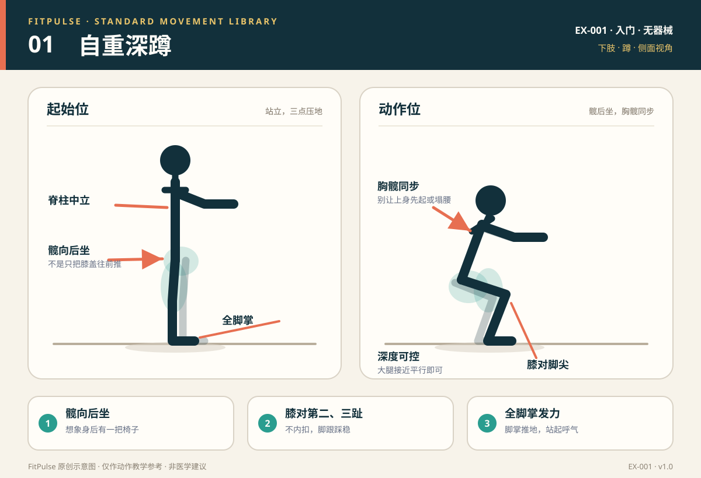

# 自重深蹲

*图示：左为起始位，右为下蹲最低位；仅作教学示意。*

## 一句话要点

髋向后坐、膝盖沿脚尖方向屈伸，全脚掌踩稳后站起；不要只把膝盖往前推。

## 目标肌群与发力感

- **主要**：股四头肌、臀大肌。
- **次要**：腘绳肌、内收肌群、竖脊肌、腹部深层肌群。
- **发力感**：起身时脚掌推地，臀部和大腿前侧共同发力。膝盖前侧应稳定，不应出现尖锐疼痛或明显“顶住”的感觉。

## 器械、场地与适用人群

- **器械**：无。
- **场地**：约 2 平方米的平整、防滑地面；背后可留出椅子作为退阶保护。
- **适用**：健康成人新手；想学习髋、膝协调下蹲的人；作为居家下肢计划的基础动作。
- **先评估**：急性膝、髋、踝损伤，近期下肢手术，明显平衡障碍，或下蹲时持续关节痛的人。

## 标准动作

### 起始位

1. 双脚约与肩同宽，脚尖自然向外 5°–15°；大脚趾、小脚趾和脚跟三点压地。
2. 双手前平举到胸前，或交叉抱在胸前；肋骨下沉，腹部轻微收紧。
3. 视线看向前下方，下巴微收，头顶向上延伸。

### 动作过程

1. 吸气，髋部向后、向下移动，同时屈膝；想象身后有一把椅子。
2. 膝盖沿第二、第三脚趾方向移动，不向内夹；脚跟保持贴地。
3. 下蹲到“大腿接近平行地面”或你能保持脊柱中立、无痛可控的深度。
4. 最低点短暂停顿，保持腹部支撑，不要完全放松后弹起。

### 结束与节奏

- 呼气，脚掌均匀推地，膝盖和髋部同时伸展，站回起始位。
- 顶端站直即可，不需要刻意把腰向后仰；臀部轻收，肋骨保持叠在骨盆上方。
- 新手节奏：下蹲 2–3 秒 → 最低点停 1 秒 → 站起 1–2 秒。

## 呼吸

下蹲时吸气，站起时呼气。若动作较慢或后续增加负重，可在下蹲前吸气并轻轻绷紧腹部建立支撑；不要长时间憋气到头晕。

## 关键对齐要点

| 部位 | 标准 | 快速自查 |
|---|---|---|
| 足部 | 三点压地，足弓不塌，脚跟不离地 | 站起时脚跟是否先抬起？ |
| 膝关节 | 与第二、第三脚趾同向，不内扣 | 从正面看，膝盖是否向中间靠？ |
| 髋部 | 向后、向下移动，与屈膝同步 | 是否只有膝盖前移，髋部没有后坐？ |
| 脊柱与胸廓 | 中立，胸廓叠在骨盆上方 | 最低点是否弓背、塌腰或肋骨外翻？ |
| 头颈 | 视线前下方，颈部放松 | 是否抬头过度、下巴前伸？ |
| 深度 | 在无痛、可控范围内，大腿接近平行 | 是否为了“蹲深”而放松腹部或脚跟离地？ |

## 常见错误与纠正

| 错误 | 典型表现 | 纠正方法 |
|---|---|---|
| 膝盖内扣 | 下蹲或站起时两膝向中间靠，足弓塌陷 | 降低深度和次数；提示“膝盖推向小脚趾方向”；先做臀中肌激活，如侧卧抬腿；必要时用轻弹力带套在膝上提供触觉反馈 |
| 脚跟离地 | 重心跑到前脚掌，脚趾抓地，脚踝前侧压力大 | 先改善踝背屈活动度；暂时把脚跟垫高 1–2 厘米（书本或杠铃片），并缩小深度；不要强行追求深蹲 |
| 弓背或塌腰 | 最低点腰椎屈曲、骨盆后倾，或腰部过度反弓 | 缩小深度，收肋骨、轻收腹部；双手前伸帮助平衡；同时改善髋和踝的活动度 |
| 重心过度前移 | 膝盖明显前冲伴脚跟离地，站起时上身先起 | 先练箱式深蹲（轻触椅面即起）；提示“髋向后坐、全脚掌压地”；降低动作速度 |
| 憋气或头晕 | 下蹲前长时间憋气，站起时眼前发黑 | 采用“吸气下蹲、呼气站起”的节奏；不要用过度憋气来换取稳定 |

## 新手组次建议

- **频率**：每周 2–3 次，尽量不与高强度下肢训练连续安排。
- **组数 × 次数**：从 2 组 × 8 次开始，逐步到 2–3 组 × 8–12 次。
- **组间休息**：60–90 秒。
- **进阶标准**：连续两次训练都能在脚跟贴地、膝盖不内扣、脊柱中立的前提下完成上限次数，再增加组数或难度。

## 降阶与进阶

- **降阶**：箱式深蹲（坐到椅子轻触即起）；扶门框或墙面辅助；脚跟微垫；半程深蹲。
- **进阶**：3 秒下蹲的节奏深蹲；最低点停顿 2 秒；胸前抱重物做高脚杯深蹲；分腿蹲或弓步蹲。
- 不建议新手一开始就用跳跃深蹲；先能稳定控制落地和膝髋对齐。

## 安全提示

- 训练前做 3–5 分钟动态热身，如原地踏步、髋关节绕环、徒手深蹲。
- 使用稳固的椅子做箱式深蹲；不要把椅子放在湿滑地面或地毯边缘。
- 出现尖锐膝痛、髋痛、踝痛、关节肿胀、麻木、眩晕或胸痛时停止，并视情况就医。
- 膝、髋、踝有旧伤，或处于术后恢复期的人，先咨询医生或康复治疗师。
- 本条目是教学信息，不构成医疗建议。

## 常见问题

**Q：深蹲时膝盖能不能超过脚尖？**  
A：没有“绝对不能超过脚尖”的通用规则。膝盖是否前移取决于腿长、踝关节活动度、下蹲深度和个体结构。更重要的是脚跟贴地、膝盖与脚尖同向、脊柱中立且无痛。为了强行让小腿垂直而过度后坐，反而可能增加髋部或腰部压力。

**Q：深蹲时膝盖有响声，还能做吗？**  
A：如果没有疼痛、肿胀、卡住或打软腿，单纯的无痛弹响通常不需要过度担心。若伴随疼痛、肿胀、关节锁住或明显不稳，应停止并找医生或康复师评估。

**Q：可以每天做深蹲吗？**  
A：力量训练更适合每周 2–3 次、非连续日安排，让肌肉有恢复时间。每天做少量徒手深蹲作为活动可以，但不建议每天高次数、高难度地练到力竭。

## 知识出处

- [S1] ACSM's Guidelines for Exercise Testing and Prescription, 11th ed.（运动筛查与训练剂量）
- [S3] ACE Exercise Library（深蹲技术要点与常见错误）
- [S4] ExRx Exercise Directory（动作模式与肌群参与）
- [S5] Mayo Clinic, Weight training: Do's and don'ts of proper technique（呼吸与受控技术）

完整书目与访问日期见 [SOURCES.md](../SOURCES.md)。

> 本条目由 FitPulse 团队整理，用于教学参考，不替代医生或线下教练的个体化评估。
