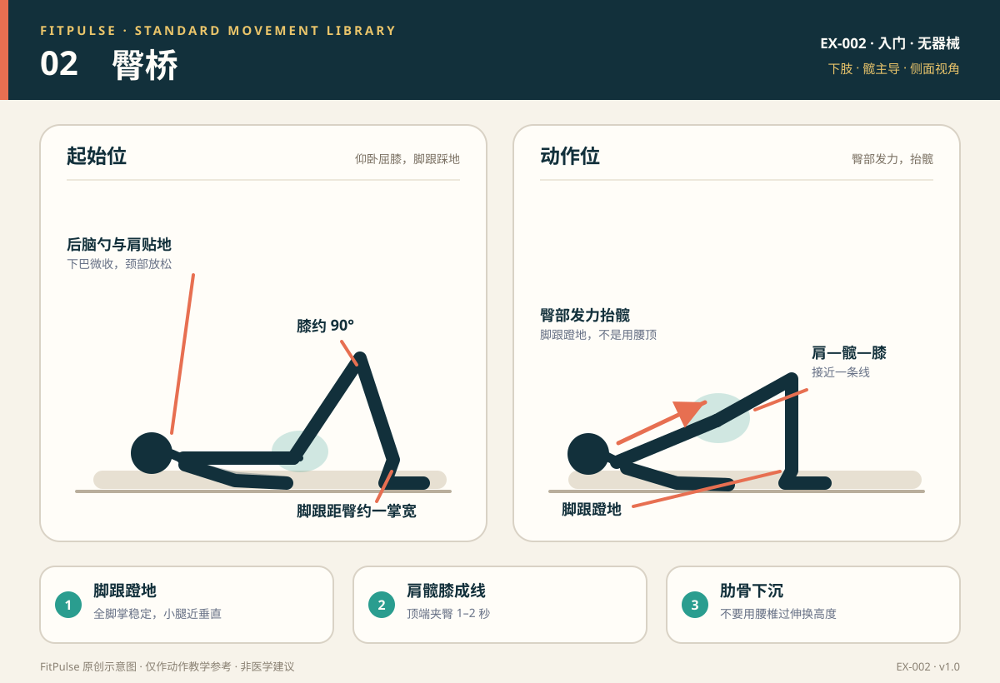

# 臀桥

*图示：左为仰卧屈膝起始位，右为抬髋标准位；仅作教学示意。*

## 一句话要点

脚跟蹬地、臀部发力把髋抬起，肩—髋—膝接近一条线；不要用腰椎过伸来换高度。

## 目标肌群与发力感

- **主要**：臀大肌、腘绳肌。
- **次要**：腹部深层肌群、竖脊肌、内收肌群。
- **发力感**：抬髋时臀部明显收紧，大腿后侧参与；腰部应稳定，而不是在顶端出现“折腰”或挤压感。

## 器械、场地与适用人群

- **器械**：无；瑜伽垫或地毯更舒适。
- **场地**：约 2 平方米，仰卧时头、肩、脚都有支撑。
- **适用**：久坐、臀部发力感弱的新手；作为深蹲、硬拉的辅助动作；低冲击下肢训练。
- **先评估**：急性腰痛伴放射痛或麻木、近期下背部/髋部手术、仰卧时明显不适的人。

## 标准动作

### 起始位

1. 仰卧屈膝，双脚与髋同宽，脚跟距离臀部约 25–35 厘米，使抬髋顶端小腿接近垂直。
2. 双臂放在身体两侧，掌心向下；下巴微收，后脑勺轻贴地面。
3. 肋骨下沉，腹部轻微收紧，先让腰背自然贴近地面，而不是用力把腰压死。

### 动作过程

1. 呼气，脚跟压地，臀部收紧，骨盆轻微后倾，缓慢把髋抬起。
2. 抬到肩、髋、膝接近一条线时停住；顶端主动夹臀 1–2 秒。
3. 保持肋骨下沉，避免为了抬更高而把腰向后折；肩部和头部始终贴地。

### 结束与节奏

- 吸气，用 2–3 秒有控制地放下髋部，臀部轻触地面后进入下一次。
- 不要直接放松砸地；全程保持腹部支撑。
- 新手节奏：抬髋 2 秒 → 顶端停 1–2 秒 → 下放 2–3 秒。

## 呼吸

抬髋时呼气，下放时吸气。顶端不要憋气；如果保持时间较长，可保持平稳呼吸并维持腹部支撑。

## 关键对齐要点

| 部位 | 标准 | 快速自查 |
|---|---|---|
| 足部 | 全脚掌踩地，主要用脚跟蹬地 | 脚尖是否翘起、脚跟是否滑动？ |
| 膝关节 | 与脚尖同向，不内扣 | 顶端两膝是否向中间靠？ |
| 髋部 | 向上伸展，顶端臀部收紧 | 是臀部把髋推起，还是腰在发力？ |
| 骨盆与肋骨 | 骨盆中立偏轻后倾，肋骨不外翻 | 顶端是否出现肋骨向前顶、腰部挤压？ |
| 脊柱 | 胸椎贴地，腰椎不过伸 | 腰下方是否出现明显空隙和挤压感？ |
| 头颈 | 后脑勺轻贴地，颈部放松 | 是否用头颈发力把身体顶起？ |

## 常见错误与纠正

| 错误 | 典型表现 | 纠正方法 |
|---|---|---|
| 用腰代偿 | 顶端腰向后折、肋骨外翻，臀部反而没感觉 | 降低抬髋高度；先呼气收肋骨、轻后倾骨盆，再抬髋；顶端只到肩—髋—膝接近一条线 |
| 脚跟离地或脚趾发力 | 前脚掌压地，小腿前侧紧张 | 调整脚跟距离，让小腿在顶端接近垂直；提示“脚跟往下踩”，可先做小幅臀桥找发力 |
| 膝盖内扣 | 抬髋时两膝向中间靠 | 减小幅度；膝盖主动向小脚趾方向分开；可在膝上套轻弹力带做触觉提示 |
| 颈部紧张 | 用头顶地、下巴抬起 | 下巴微收，后脑勺轻贴地；把注意力放在臀部和脚跟 |
| 借助惯性 | 快速甩髋、落地砸地 | 降低速度，顶端停 1–2 秒；每组次数减少，保证每次都能控制 |
| 大腿后侧抽筋 | 腘绳肌先疲劳，臀部无感 | 把脚稍微靠近臀部，减小抬髋高度；先做臀肌激活；抽筋时立即停止并轻柔拉伸 |

## 新手组次建议

- **频率**：每周 2–3 次，可作为下肢训练的热身或收尾。
- **组数 × 次数**：2–3 组 × 10–15 次，顶端停 1–2 秒。
- **组间休息**：45–60 秒。
- **进阶标准**：能稳定完成 15 次且腰部无挤压感，再尝试单腿臀桥或增加停顿时间。

## 降阶与进阶

- **降阶**：只做骨盆前后倾练习；小幅度臀桥；双脚靠近臀部；减少顶端停顿。
- **进阶**：单腿臀桥；双脚垫高；臀桥行走（交替抬脚）；在髋部放轻负重。
- 单腿臀桥对骨盆稳定要求更高，先确保双腿版本能保持骨盆水平。

## 安全提示

- 在平整防滑的地面铺垫子；避免头部直接压在硬地板上。
- 出现腰部尖锐痛、腿部放射痛、麻木或明显颈部不适时停止。
- 不要为了追求抬髋高度而过度挺腰；高度不是唯一标准。
- 本条目是教学信息，不构成医疗建议。

## 常见问题

**Q：臀桥做完腰酸、屁股没感觉，怎么办？**  
A：先降低高度，呼气收肋骨、轻后倾骨盆，再用脚跟蹬地抬髋；顶端只夹臀 1–2 秒，不要继续把腰往上顶。也可以先做小幅度臀桥或侧卧抬腿激活臀肌。

**Q：臀桥抬得越高越好吗？**  
A：不是。抬到肩、髋、膝接近一条线即可。继续抬高通常会让腰椎过伸，增加腰部压力，而不是增加臀部训练效果。

**Q：大腿后侧总是抽筋？**  
A：常见原因是脚离臀部太远、抬得过高或腘绳肌代偿。把脚稍微靠近臀部、减小幅度，先找臀部发力；反复抽筋或持续疼痛时应停止并评估。

## 知识出处

- [S3] ACE Exercise Library（臀桥技术要点与常见错误）
- [S4] ExRx Exercise Directory（臀部与后链肌群参与）
- [S5] Mayo Clinic, Weight training: Do's and don'ts of proper technique（受控动作与呼吸）

完整书目与访问日期见 [SOURCES.md](../SOURCES.md)。

> 本条目由 FitPulse 团队整理，用于教学参考，不替代医生或线下教练的个体化评估。
