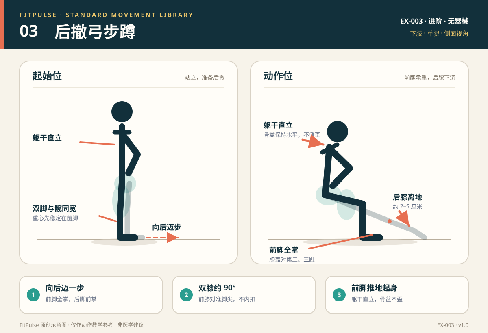

# 后撤弓步蹲

*图示：左为站立起始位，右为后撤下蹲最低位；仅作教学示意。*

## 一句话要点

向后迈步而不是向前扑；前脚全掌踩稳，双膝约 90°，躯干保持直立。

## 目标肌群与发力感

- **主要**：股四头肌、臀大肌。
- **次要**：腘绳肌、内收肌群、小腿肌群、核心肌群。
- **发力感**：前腿承担主要重量，起身时前脚推地、臀部收紧；后腿更多负责支撑和平衡，不应把大部分力量压在后膝上。

## 器械、场地与适用人群

- **器械**：无；平衡不稳时可扶墙、门框或稳固椅背。
- **场地**：约 2 平方米，前后各留出一步距离。
- **适用**：已经能稳定完成自重深蹲、想加入单腿训练的新手；希望提高下肢力量与平衡的人。
- **先评估**：急性膝/髋/踝损伤、明显平衡障碍、近期下肢手术，或单腿承重时疼痛的人。

## 标准动作

### 起始位

1. 自然站立，双脚与髋同宽，双手叉腰或自然垂在身体两侧。
2. 肋骨下沉，腹部轻微收紧，视线平视前方。
3. 先把重心稳定在前脚，再准备向后迈步。

### 动作过程

1. 一只脚向后迈出约 60–75 厘米，前脚掌先落地，脚跟自然抬起。
2. 同时弯曲双膝，身体垂直下沉；前腿膝盖沿脚尖方向移动，后膝向地面靠近。
3. 下到前大腿接近平行、双膝约 90°，后膝在离地 2–5 厘米处停住。
4. 前脚全掌压地，骨盆保持水平，躯干直立或轻微前倾，不要向一侧歪。

### 结束与节奏

- 呼气，前脚推地，伸膝伸髋回到站立；后脚收回，换另一侧。
- 下蹲 2–3 秒，最低点停 0–1 秒，起身 1–2 秒。
- 如果平衡不稳，可以在最低点轻触地面后收回，不必强行保持很久。

## 呼吸

向后迈步并下蹲时吸气，前脚推地起身时呼气。动作过程中保持腹部支撑，不要憋气。

## 关键对齐要点

| 部位 | 标准 | 快速自查 |
|---|---|---|
| 前脚 | 全脚掌踩稳，脚跟不离地 | 前脚跟是否抬起、脚掌是否内翻？ |
| 前膝 | 与脚尖同向，约 90°，不内扣 | 膝盖是否向中间塌？ |
| 后膝 | 朝地面下沉，离地 2–5 厘米 | 后膝是否砸地或向内扣？ |
| 骨盆 | 左右保持水平，不旋转 | 一侧髋是否明显掉下去？ |
| 躯干 | 直立或轻微前倾，胸廓叠在骨盆上方 | 是否弯腰、向一侧歪或过度前扑？ |
| 步幅 | 后撤距离足够，前小腿接近垂直 | 步幅太短是否导致前膝压力过大？ |

## 常见错误与纠正

| 错误 | 典型表现 | 纠正方法 |
|---|---|---|
| 前膝内扣 | 下蹲或起身时前膝向中间靠，足弓塌 | 减小步幅和深度；提示膝盖对准第二、三趾；先做侧向弹力带行走或侧卧抬腿激活臀中肌 |
| 步幅太短 | 前膝明显前冲、脚跟离地，后膝很快触地 | 向后多迈半步；先在地面放一条标记线，找到能让前小腿接近垂直的距离 |
| 躯干前扑或侧歪 | 上身向前趴，或重心压到一侧 | 降低深度；双手前平举帮助平衡；提示“胸廓叠在骨盆上方”，起身时前脚推地 |
| 后膝砸地 | 下降过快，后膝直接撞地 | 放慢离心速度；在膝盖下方放软垫作为距离提示；减少深度 |
| 后腿承担太多 | 起身主要靠后脚蹬地，前腿发力少 | 把重心放在前脚中后部；后脚只做轻支撑；减小步幅或先练分腿蹲 |
| 失去平衡 | 脚踝晃动、身体左右摆 | 扶墙或椅背完成；缩小幅度；先练静态分腿蹲，再过渡到后撤弓步 |

## 新手组次建议

- **频率**：每周 2 次，放在下肢训练日中，与深蹲错开高强度刺激。
- **组数 × 次数**：2 组 × 每侧 8–10 次；先做优势侧，再让另一侧完成相同次数。
- **组间休息**：60 秒。
- **进阶标准**：两侧都能在骨盆水平、前脚全掌、无痛的前提下完成 10 次，再增加组数或负重。

## 降阶与进阶

- **降阶**：扶墙/椅背的后撤弓步；原地分腿蹲；只做后撤步不下降；缩小深度。
- **进阶**：前弓步；行走弓步；双手持轻哑铃；后脚垫高的分腿蹲。
- 不建议新手同时追求深幅度、负重和快速节奏；先稳定骨盆与膝盖轨迹。

## 安全提示

- 在平整防滑地面练习，身后不要有桌角、门槛或宠物。
- 平衡不稳时一定扶稳固支撑物，不要扶带轮子的椅子。
- 出现膝、髋、踝尖锐疼痛，或后膝触地疼痛时停止并降低难度。
- 本条目是教学信息，不构成医疗建议。

## 常见问题

**Q：后撤弓步和前弓步有什么区别？**  
A：后撤弓步向后迈步，前腿通常更容易保持稳定，膝盖前冲感可能更小；前弓步对向前制动和股四头肌刺激更多。两者都是单腿训练，选择取决于膝部舒适度、平衡能力和训练目标。

**Q：前膝能不能超过脚尖？**  
A：同样没有绝对限制。关键是前脚全掌踩稳、膝盖与脚尖同向、骨盆水平且无痛。步幅过短会让前膝过度前冲，步幅过长则可能让后腿难以稳定；以能保持控制和舒适为准。

**Q：后膝一定要碰到地面吗？**  
A：不需要。后膝在离地 2–5 厘米处停住即可，既能保证活动范围，也能减少膝部撞击和地面不洁带来的不适。

## 知识出处

- [S1] ACSM's Guidelines for Exercise Testing and Prescription, 11th ed.（运动筛查与训练安排）
- [S3] ACE Exercise Library（弓步技术要点与常见错误）
- [S4] ExRx Exercise Directory（单腿动作模式与肌群参与）

完整书目与访问日期见 [SOURCES.md](../SOURCES.md)。

> 本条目由 FitPulse 团队整理，用于教学参考，不替代医生或线下教练的个体化评估。
