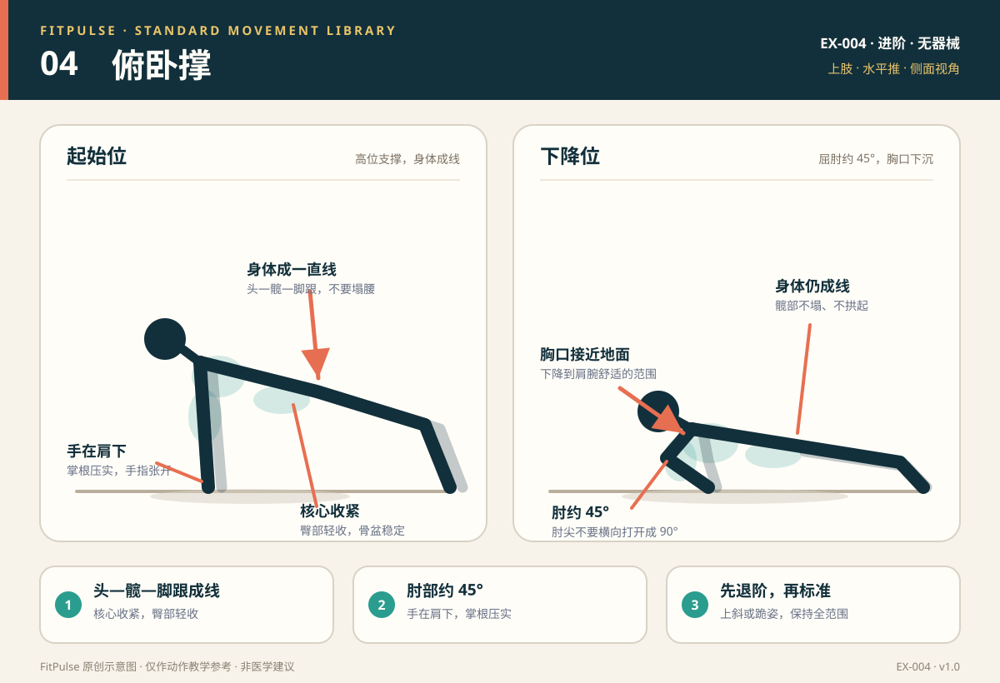

# 俯卧撑（含跪姿退阶）

*图示：左为高位支撑，右为屈肘下降位；仅作教学示意。*

## 一句话要点

手在肩下、身体从头到脚跟成一条直线；肘部斜向后约 45°，胸口接近地面后推起。

## 目标肌群与发力感

- **主要**：胸大肌、肱三头肌、三角肌前束。
- **次要**：核心肌群、臀大肌、前锯肌。
- **发力感**：推起时手掌压地，胸口和手臂后侧共同发力；腹部和臀部保持收紧，腰部不应下塌或出现挤压。

## 器械、场地与适用人群

- **器械**：无；退阶可用稳固桌面、台面或沙发边；手腕不适可用俯卧撑支架。
- **场地**：约 2 平方米的平整防滑地面。
- **适用**：已能做高位支撑、想训练上肢推力与核心稳定的新手；可用上斜或跪姿版本入门。
- **先评估**：急性腕、肘、肩、胸部损伤；撑地时手腕或肩部疼痛；近期上肢手术。

## 标准动作

### 起始位

1. 双手撑地，略宽于肩，位于肩膀正下方或略低；手指自然张开，掌根压实。
2. 双脚与髋同宽，脚趾踩地；收紧臀部与腹部，让头、髋、脚跟接近一条直线。
3. 肩胛骨保持稳定，不要耸肩；视线看向双手前下方，下巴微收。

### 动作过程

1. 吸气，屈肘让胸口向地面靠近；上臂与躯干约呈 30°–45°，不要完全横向打开成 90°。
2. 保持头、髋、脚跟一条线，髋部不要下沉或向上拱起。
3. 胸口下降到离地约 2–5 厘米，或在肩、腕舒适范围内停住。
4. 呼气，手掌推地，伸肘回到高位；顶端手臂接近伸直即可，不要用力耸肩或锁死肘关节。

### 结束与节奏

- 下降 2 秒 → 最低点停 0–1 秒 → 推起 1–2 秒。
- 如果只能完成半程，优先用上斜或跪姿版本补足范围，而不是在标准版本里缩小幅度。

## 呼吸

下降时吸气，推起时呼气。全程保持腹部和臀部轻微收紧；不要憋气到脸红或头晕。

## 关键对齐要点

| 部位 | 标准 | 快速自查 |
|---|---|---|
| 手与肩 | 手在肩下或略低，掌根压实 | 手腕是否折得过大、肩膀是否向前掉？ |
| 肘部 | 与躯干约 30°–45°，斜向后 | 肘尖是否完全横向打开？ |
| 躯干 | 头、髋、脚跟接近一条直线 | 腰部是否下塌，或臀部是否拱得很高？ |
| 核心与臀部 | 腹部收紧，臀部轻收 | 推起时骨盆是否左右晃？ |
| 肩胛 | 稳定，不耸肩 | 耳朵是否向肩膀靠近？ |
| 头颈 | 视线前下方，下巴微收 | 是否抬头、下巴前伸？ |

## 常见错误与纠正

| 错误 | 典型表现 | 纠正方法 |
|---|---|---|
| 腰部下塌 | 髋部低于肩踝连线，腰有挤压感 | 先做上斜俯卧撑；收紧腹部和臀部；减少次数，保证每次身体成线 |
| 臀部拱起 | 髋部高于肩踝连线，像“倒 V” | 把胸口向地面方向送，而不是把屁股往后坐；用高位支撑练身体线 |
| 肘部过度外展 | 肘尖向两侧打开接近 90°，肩前侧压力大 | 手略收回肩下；提示“腋下夹角约 45°”；降低难度，避免硬撑 |
| 耸肩 | 推起时肩膀向耳朵靠近 | 手掌向地面推，肩胛骨向下稳定；顶端不要过度锁肘 |
| 头前伸或抬头 | 下巴先碰地，颈部紧张 | 下巴微收，视线看向双手前下方；保持头颈与躯干延长 |
| 半程动作 | 只下降几厘米就推起 | 改用上斜或跪姿，完成可控的全范围；必要时只做离心下降 |
| 手腕疼痛 | 手腕过度背伸，掌根压力集中 | 用俯卧撑支架或握拳支撑；先做腕部热身；持续疼痛时停止并评估 |

## 新手组次建议

- **频率**：每周 2–3 次，非连续日。
- **组数 × 次数**：2–3 组 × 6–12 次；如果标准版做不到 6 次，先做上斜或跪姿 8–12 次。
- **组间休息**：60 秒。
- **进阶标准**：能连续两次在身体成线的前提下完成 12 次标准俯卧撑，再降低支撑高度或增加难度。

## 降阶与进阶

- **降阶**：墙面俯卧撑 → 高台面俯卧撑 → 低台面俯卧撑 → 跪姿俯卧撑 → 标准俯卧撑。
- **进阶**：3 秒离心俯卧撑；双脚垫高；窄距俯卧撑；在可控范围内增加负重。
- 跪姿俯卧撑不是“无效动作”，它只是缩短力臂、降低负荷；保持膝—髋—头成线，不要塌腰或撅臀。

## 安全提示

- 使用稳固的桌面或台面做上斜俯卧撑，避免带轮子的椅子、玻璃桌或边缘松动的家具。
- 手腕、肘或肩出现尖锐疼痛时停止；不要用疼痛的关节硬撑。
- 训练前做手腕、肩胛和胸椎的准备活动。
- 本条目是教学信息，不构成医疗建议。

## 常见问题

**Q：一个标准俯卧撑都做不了，怎么开始？**  
A：从墙面或高台面俯卧撑开始，逐步降低支撑高度；也可以做跪姿俯卧撑或只做离心下降。目标是保持身体成线，并在可控范围内完成 6–12 次，而不是一开始就追求标准版。

**Q：跪姿俯卧撑有用吗？**  
A：有用。跪姿减少了身体重量和力臂，仍然训练胸、肩、肱三头肌和核心稳定。关键是膝盖到头部保持一条直线，不要撅臀或塌腰。

**Q：宽距和窄距有什么区别？**  
A：宽距通常增加胸大肌参与，窄距更强调肱三头肌，但过宽或过窄都可能增加肩、腕压力。新手以肩宽或略宽于肩的舒适位置为主，不必追求极端手距。

**Q：做俯卧撑手腕疼怎么办？**  
A：可改用俯卧撑支架、六角哑铃或握拳支撑，减少手腕背伸；先做腕部热身。若疼痛持续、伴肿胀或麻木，应停止并找医生或康复师评估。

## 知识出处

- [S3] ACE Exercise Library（俯卧撑技术要点、退阶与常见错误）
- [S4] ExRx Exercise Directory（胸部、肩部与肱三头肌参与）
- [S5] Mayo Clinic, Weight training: Do's and don'ts of proper technique（受控动作与呼吸）

完整书目与访问日期见 [SOURCES.md](../SOURCES.md)。

> 本条目由 FitPulse 团队整理，用于教学参考，不替代医生或线下教练的个体化评估。
