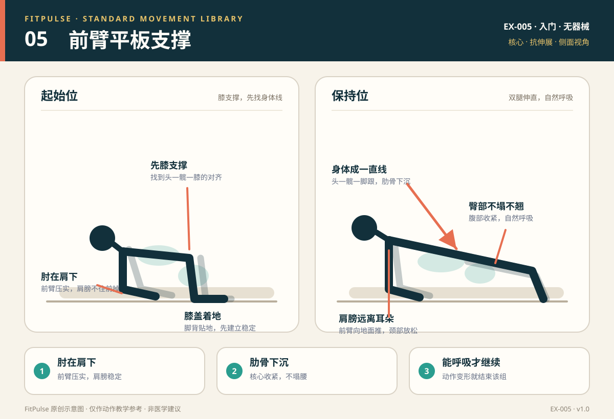

# 前臂平板支撑

*图示：左为膝支撑起始位，右为双腿伸直的保持位；仅作教学示意。*

## 一句话要点

肘在肩下，头—髋—脚跟成一条线；肋骨下沉、臀部轻收，用呼吸维持，而不是硬撑到动作变形。

## 目标肌群与发力感

- **主要**：腹直肌、腹斜肌、腹横肌。
- **次要**：竖脊肌、臀大肌、肩带稳定肌群。
- **发力感**：腹部整体收紧，像把肋骨和骨盆轻轻拉近；臀部参与稳定，肩膀有支撑感。腰部不应出现下塌后的挤压或酸痛。

## 器械、场地与适用人群

- **器械**：无；瑜伽垫或软垫可保护前臂和膝盖。
- **场地**：约 2 平方米的平整地面。
- **适用**：想学习核心抗伸展、改善身体线的新手；可作为力量训练的热身或收尾。
- **先评估**：急性腕、肘、肩损伤；俯卧支撑时腰腿放射痛或麻木；近期腹部/肩部手术。

## 标准动作

### 起始位

1. 前臂撑地，肘关节位于肩膀正下方；前臂平行或轻微内收，拳头或手掌朝下均可。
2. 双脚与髋同宽，脚趾踩地；可以先让膝盖着地，降低难度。
3. 收紧腹部与臀部，让头、髋、脚跟接近一条直线；视线看向双手前下方。

### 动作过程

1. 呼气，膝盖离地，脚趾踩稳，身体保持一条直线。
2. 前臂向地面推，肩膀远离耳朵；肋骨下沉，骨盆保持中立。
3. 保持自然呼吸，不要憋气；只坚持到动作仍能稳定的时间。

### 结束与节奏

- 到达预定时间或动作开始变形前，膝盖轻放回地面，再起身。
- 每组之间休息 30–45 秒；下一组重新建立对齐，不靠“塌腰硬撑”完成。
- 新手节奏：20–30 秒一组，动作质量优先于时长。

## 呼吸

保持平稳呼吸，建议用 3–5 秒吸气、3–5 秒呼气。不要为了“更稳”而长时间憋气；如果无法自然呼吸，说明强度或时长已经超过当前能力。

## 关键对齐要点

| 部位 | 标准 | 快速自查 |
|---|---|---|
| 肘与肩 | 肘在肩正下方，前臂压实 | 肩膀是否跑到肘前方？ |
| 躯干 | 头、髋、脚跟接近一条直线 | 腰部是否下塌，或臀部是否拱高？ |
| 骨盆 | 中立，臀部轻收 | 是否出现腰部挤压或骨盆前倾？ |
| 肋骨 | 下沉，腹部收紧 | 是否肋骨外翻、胸廓向前顶？ |
| 肩胛 | 稳定，肩膀远离耳朵 | 是否耸肩、颈部紧张？ |
| 头颈 | 视线前下方，颈部延长 | 是否低头过度或抬头？ |

## 常见错误与纠正

| 错误 | 典型表现 | 纠正方法 |
|---|---|---|
| 腰部下塌 | 髋部低于肩踝连线，腰有挤压感 | 立刻结束该组；改用膝支撑或高台面平板；收紧腹部和臀部，缩短时间 |
| 臀部拱高 | 髋部高于肩踝连线，像倒 V | 把髋部放低到身体成线；膝盖着地重新建立对齐；不要为了“轻松”把屁股撅高 |
| 憋气 | 脸憋红、无法说话、结束后头晕 | 保持自然呼吸；把每组时间缩短到能稳定呼吸的长度 |
| 耸肩 | 肩膀向耳朵靠近，颈部紧张 | 前臂向地面推，肩胛骨向下稳定；肘保持在肩下 |
| 肘在肩前 | 肩膀向前掉，手腕/肩压力大 | 肘向后调到肩正下方；缩短前臂支撑距离；先做膝支撑 |
| 只追求时长 | 60 秒后腰塌、骨盆歪，仍继续撑 | 以动作质量结束一组；用加难度动作替代无休止延长时间 |

## 新手组次建议

- **频率**：每周 2–3 次，可放在力量训练后或核心日。
- **组数 × 时长**：2–3 组 × 20–30 秒；能稳定完成后再增加到 40–45 秒。
- **组间休息**：30–45 秒。
- **进阶标准**：连续两次训练都能在身体成线、自然呼吸的前提下完成 45 秒，再考虑增加难度，而不是无限延长。

## 降阶与进阶

- **降阶**：膝支撑平板；前臂撑在稳固台面上（台面越高越容易）；缩短到 10–15 秒；只练骨盆中立和呼吸。
- **进阶**：延长到 45–60 秒；肩胛俯卧撑；交替抬脚；在身体线稳定的前提下做轻微前后移动。
- 不建议新手在腰部塌陷时加负重或做高难度变式。

## 安全提示

- 前臂和膝盖下垫软垫；避免在湿滑地面撑地。
- 出现腰痛、腿麻、肩痛、肘痛或头晕时立即停止。
- 平板支撑是核心稳定练习，不是“治腰痛”的动作；腰痛持续或反复时应先评估。
- 本条目是教学信息，不构成医疗建议。

## 常见问题

**Q：平板支撑越久越厉害吗？**  
A：不是。超过当前控制能力的时长会让腰塌、骨盆歪、憋气，训练价值反而下降。新手以 20–30 秒高质量完成为起点，逐步增加到 45–60 秒；之后更建议增加难度或变换动作，而不是一味堆时间。

**Q：做平板支撑腰疼怎么办？**  
A：先停止该组，改用膝支撑或高台面版本，缩短时间；检查是否腰部下塌、肋骨外翻或憋气。若腰痛伴腿麻、放射痛或持续不缓解，应找医生或康复师评估。

**Q：肘部应该撑在什么地方？**  
A：肘关节在肩膀正下方，前臂压实地面。肘太靠前会让肩膀向前掉，增加肩腕压力；肘太靠后则难以稳定。

## 知识出处

- [S3] ACE Exercise Library（平板支撑技术要点与常见错误）
- [S4] ExRx Exercise Directory（核心肌群参与）
- [S5] Mayo Clinic, Weight training: Do's and don'ts of proper technique（呼吸与受控技术）

完整书目与访问日期见 [SOURCES.md](../SOURCES.md)。

> 本条目由 FitPulse 团队整理，用于教学参考，不替代医生或线下教练的个体化评估。
