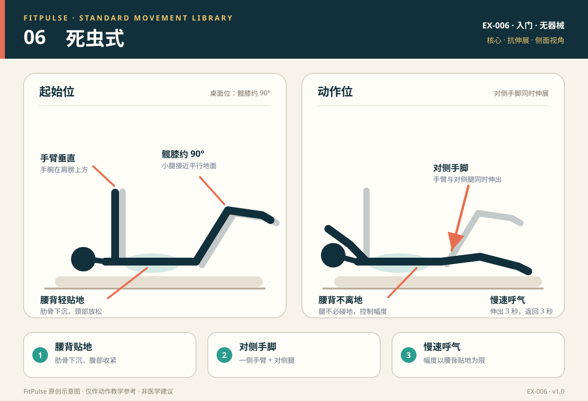

# 死虫式

*图示：左为仰卧桌面位，右为对侧手脚伸展位；仅作教学示意。*

## 一句话要点

仰卧收肋骨，腰背轻贴地；对侧手脚缓慢伸出，只到腰背仍贴地、骨盆不晃的范围。

## 目标肌群与发力感

- **主要**：腹横肌、腹直肌、腹斜肌。
- **次要**：髋屈肌、臀大肌、竖脊肌。
- **发力感**：腹部深层持续收紧，像把下肋骨轻轻拉向骨盆；腰背稳定贴地，四肢移动时骨盆不左右晃。颈部和大腿前侧不应抢戏。

## 器械、场地与适用人群

- **器械**：无；瑜伽垫或软垫更舒适。
- **场地**：约 2 平方米，能平躺并伸展四肢。
- **适用**：想学习核心抗伸展、改善腰部控制的新手；久坐、腰背容易代偿的人；作为力量训练前的核心激活。
- **先评估**：急性腰痛、仰卧时疼痛加重、近期腹部/髋部手术，或无法舒适仰卧的人。

## 标准动作

### 起始位

1. 仰卧，双臂垂直指向天花板，手腕在肩膀上方。
2. 髋、膝都约 90°，小腿接近平行地面，双脚离地。
3. 肋骨下沉，腹部轻收，让腰背自然贴近地面；下巴微收，颈部放松。

### 动作过程

1. 呼气，缓慢把一侧手臂向头顶方向伸展，同时把对侧腿向地面方向伸出。
2. 只伸到腰背仍能贴地、骨盆不晃、腹部仍能保持收紧的位置；不要追求手脚碰地。
3. 在末端停 1 秒，吸气，沿原路回到起始位；换另一侧。

### 结束与节奏

- 伸出 3 秒 → 末端停 1 秒 → 返回 3 秒。
- 动作全程慢，避免甩动；每侧完成相同次数。
- 如果腰背开始离地，立即缩小幅度或只做单侧肢体。

## 呼吸

伸出时缓慢呼气，返回时吸气。呼气有助于保持肋骨下沉和腹部收紧；不要憋气，也不要在末端放松腹部。

## 关键对齐要点

| 部位 | 标准 | 快速自查 |
|---|---|---|
| 腰背 | 轻贴地面，不出现明显空隙 | 手伸远时腰是否拱起？ |
| 骨盆 | 保持中立，不左右晃或前倾 | 一侧髋是否跟着腿抬起？ |
| 肋骨 | 下沉，腹部持续收紧 | 是否肋骨外翻、腹部鼓起？ |
| 四肢 | 对侧手脚同时伸出，速度一致 | 是否只动腿、手臂不动？ |
| 颈部 | 下巴微收，颈部放松 | 是否用脖子发力、下巴抬起？ |
| 幅度 | 以腰背贴地为上限 | 是否为了碰地而拱腰？ |

## 常见错误与纠正

| 错误 | 典型表现 | 纠正方法 |
|---|---|---|
| 腰背离地 | 腿伸得越低，腰越拱，出现挤压感 | 缩小腿的伸出范围；膝盖多弯一点；先只做单腿或单臂；呼气时保持肋骨下沉 |
| 动作太快 | 手脚甩动，骨盆左右晃 | 放慢到 3 秒伸出、3 秒返回；必要时减少次数 |
| 腿伸得太低 | 追求脚碰地，腰部代偿 | 把“腰背贴地”作为幅度上限；脚不必碰地 |
| 颈部紧张 | 下巴抬起、脖子前侧发力 | 下巴微收，后脑勺轻贴地；把注意力放在腹部 |
| 憋气 | 动作中屏住呼吸，结束后才喘气 | 伸出时持续呼气，返回时吸气；每组次数减少 |
| 骨盆跟着转 | 一侧髋抬起或身体滚动 | 减小幅度；在对侧膝盖上方放一只手做触觉提示；先做死虫式的单侧版本 |

## 新手组次建议

- **频率**：每周 2–3 次，可作为热身或核心训练的一部分。
- **组数 × 次数**：2–3 组 × 每侧 6–8 次。
- **组间休息**：30–45 秒。
- **进阶标准**：连续两次训练都能在腰背贴地、骨盆稳定的前提下完成 8 次/侧，再增加幅度、停顿或难度。

## 降阶与进阶

- **降阶**：只做脚跟轻点；只伸一条腿或一条手臂；缩小伸展范围；双脚先放在地上再抬起。
- **进阶**：增加伸展幅度；末端停 2–3 秒；手脚同时更慢地伸出；在手腕/脚踝加轻阻力带。
- 不建议用“手脚越低越厉害”作为标准；控制住腰背和骨盆才是目标。

## 安全提示

- 在平整地面铺垫子；颈部不适时可在头下垫薄毛巾。
- 出现腰痛、腿麻、放射痛、头晕或恶心时停止。
- 死虫式不是“治好腰痛”的保证；腰痛反复或伴神经症状时应先评估。
- 本条目是教学信息，不构成医疗建议。

## 常见问题

**Q：腿伸下去腰就离地，怎么办？**  
A：这是幅度超过当前控制能力的信号。把腿伸出的距离缩短、膝盖多弯一点，先保证腰背贴地；也可以只做单腿伸展，或在呼气时再伸远一点。不要用手硬压腰。

**Q：死虫式比卷腹更好吗？**  
A：两者目标不同。死虫式强调抗伸展和四肢协调，对腰背控制要求高；卷腹更直接训练腹直肌屈曲。选择取决于训练目标和腰部舒适度，不需要二选一。

**Q：为什么我做的时候大腿前侧很酸？**  
A：髋屈肌在维持屈髋姿势时会参与。若大腿前侧明显代偿，可把脚放低一点或减少每组次数，先建立腹部主导；动作中避免憋气和骨盆前倾。

## 知识出处

- [S3] ACE Exercise Library（死虫式技术要点与退阶思路）
- [S4] ExRx Exercise Directory（核心肌群与髋屈肌参与）

完整书目与访问日期见 [SOURCES.md](../SOURCES.md)。

> 本条目由 FitPulse 团队整理，用于教学参考，不替代医生或线下教练的个体化评估。
