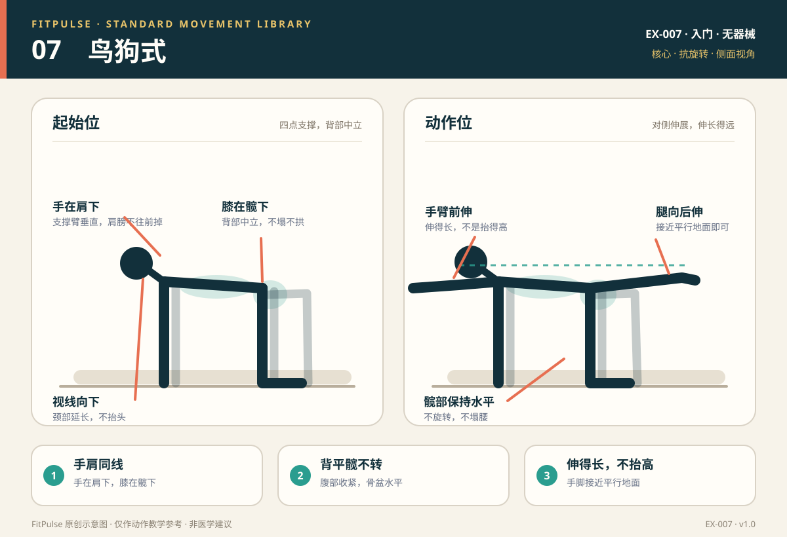

# 鸟狗式

*图示：左为四点支撑起始位，右为对侧手脚伸展位；仅作教学示意。*

## 一句话要点

四点支撑，背平、髋不转；对侧手臂前伸、腿后伸，伸得长而不是抬得高。

## 目标肌群与发力感

- **主要**：腹横肌、腹斜肌、竖脊肌。
- **次要**：臀大肌、三角肌、肩袖肌群。
- **发力感**：腹部与腰背共同稳定躯干，臀部和支撑肩持续工作；伸展时身体像一条长桌，不应出现一侧髋抬高或腰部下塌。

## 器械、场地与适用人群

- **器械**：无；瑜伽垫或软垫可保护手腕和膝盖。
- **场地**：约 2 平方米的平整地面。
- **适用**：想训练核心抗旋转、改善四肢协调的新手；久坐、腰背稳定不足的人；作为热身或核心训练。
- **先评估**：急性腕、膝、肩损伤；四点支撑时腰痛或腿麻；明显平衡障碍。

## 标准动作

### 起始位

1. 四点跪撑：双手在肩膀正下方，双膝在髋部正下方，脚背贴地或脚趾踩地。
2. 背部保持中立，不塌腰也不拱背；视线看向双手之间的地面。
3. 腹部轻收，肩膀远离耳朵，重量均匀分布在双手和双膝。

### 动作过程

1. 呼气，收紧腹部和臀部，先稳定躯干。
2. 一侧手臂向前伸出，同时对侧腿向后伸出；手臂和腿接近与地面平行即可。
3. 保持骨盆水平、背部平直，伸展 2–3 秒；不要为了抬高腿而让腰下塌或髋部旋转。
4. 吸气，缓慢收回手脚，回到四点支撑；换另一侧。

### 结束与节奏

- 伸出 2 秒 → 保持 2–3 秒 → 收回 2 秒。
- 每侧完成相同次数；如果开始晃动，缩短保持时间而不是加快速度。
- 也可以先只伸手臂或只伸腿，稳定后再做对侧组合。

## 呼吸

伸出时呼气，保持时自然呼吸，收回时吸气。不要憋气；呼吸乱了通常说明稳定已经下降。

## 关键对齐要点

| 部位 | 标准 | 快速自查 |
|---|---|---|
| 手与肩 | 手在肩下，支撑臂垂直 | 肩膀是否向前掉或耸肩？ |
| 膝与髋 | 膝在髋下，支撑腿垂直 | 支撑侧膝盖是否向内倒？ |
| 背部 | 中立平直，不塌腰不拱背 | 伸展时腰是否下塌？ |
| 骨盆 | 左右水平，不旋转 | 一侧髋是否明显抬高？ |
| 伸展幅度 | 手臂、腿接近平行地面 | 是否把腿抬得过高、腰后仰？ |
| 头颈 | 视线向下，颈部延长 | 是否抬头看前方？ |

## 常见错误与纠正

| 错误 | 典型表现 | 纠正方法 |
|---|---|---|
| 髋部旋转 | 一侧髋抬高，骨盆向伸展侧翻转 | 降低腿的抬高幅度；在髋部上方放一根轻杆或手掌做触觉提示；先只做单腿伸展 |
| 腰部下塌 | 伸展腿时腰向下沉，出现挤压感 | 收紧腹部和臀部；腿只伸到与地面平行；缩短保持时间 |
| 腿抬得太高 | 追求“抬得高”，腰后仰 | 提示“向后伸，不是向上抬”；脚不必高过髋部 |
| 手臂抬得太高 | 手臂超过肩线，肩部紧张 | 手臂向前伸即可；肩膀远离耳朵，支撑手压实 |
| 头抬起 | 抬头看前方，颈部紧张 | 视线落在双手之间；下巴微收 |
| 动作过快 | 手脚甩出、身体晃动 | 放慢节奏；每侧 6 次开始；先做单侧版本 |

## 新手组次建议

- **频率**：每周 2–3 次，可放在热身或核心训练中。
- **组数 × 次数**：2–3 组 × 每侧 6–8 次，末端保持 2–3 秒。
- **组间休息**：30–45 秒。
- **进阶标准**：连续两次训练都能在骨盆水平、背部中立的前提下完成 8 次/侧，再延长保持时间或增加难度。

## 降阶与进阶

- **降阶**：只伸单臂；只伸单腿；缩短保持时间；在手腕或膝盖下加软垫。
- **进阶**：延长末端保持；在手腕和脚踝加轻阻力带；肘膝相触再伸展；增加慢速控制。
- 不建议通过抬高腿来增加难度；那通常只是增加腰部代偿。

## 安全提示

- 手腕不适可在掌下垫毛巾或改用拳头支撑；膝盖下垫软垫。
- 出现腰痛、腿麻、肩痛或手腕痛时停止。
- 鸟狗式强调稳定而非大幅度；动作变形时应缩小幅度。
- 本条目是教学信息，不构成医疗建议。

## 常见问题

**Q：鸟狗式做完腰酸，正常吗？**  
A：轻微肌肉疲劳可以观察，但明显腰部挤压或酸痛通常提示腰部代偿。降低腿的抬高幅度、收紧腹部和臀部，先只做单腿或单臂版本；若伴随腿麻或放射痛，应停止并评估。

**Q：腿要抬多高？**  
A：抬到与地面接近平行即可，不需要高过髋部。腿抬得越高，腰椎越容易过伸；目标是“伸得长”，而不是“抬得高”。

**Q：手腕疼怎么办？**  
A：检查手是否在肩下、掌根是否均匀压实；可在掌下垫毛巾、改用拳头支撑，或先做前臂支撑的变式。持续疼痛应停止并找医生或康复师评估。

## 知识出处

- [S3] ACE Exercise Library（鸟狗式技术要点与常见错误）
- [S4] ExRx Exercise Directory（核心、臀部与肩部参与）

完整书目与访问日期见 [SOURCES.md](../SOURCES.md)。

> 本条目由 FitPulse 团队整理，用于教学参考，不替代医生或线下教练的个体化评估。
