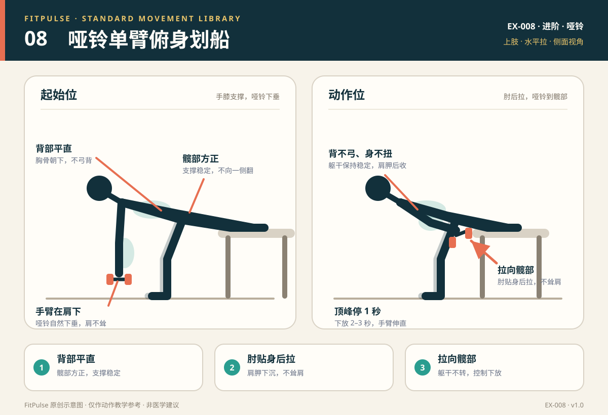

# 哑铃单臂俯身划船

*图示：左为手膝支撑起始位，右为肘部后拉、哑铃靠近髋部；仅作教学示意。*

## 一句话要点

一手一膝支撑，背部平直；肘贴身后拉，把哑铃拉向髋部，不要扭身或耸肩借力。

## 目标肌群与发力感

- **主要**：背阔肌、菱形肌、中下斜方肌。
- **次要**：肱二头肌、三角肌后束、前臂肌群、核心肌群。
- **发力感**：拉起时肩胛骨向后下方收，肘部沿身体侧面移动，背部侧面和上背有收缩感；腰部应稳定，不应出现扭转或酸痛。

## 器械、场地与适用人群

- **器械**：一只哑铃；一张稳固的椅子或训练凳。
- **场地**：约 2 平方米，椅子靠墙或确认不会滑动。
- **适用**：已掌握髋铰链、想训练背部拉力的人；久坐、上背力量不足的新手；哑铃居家训练。
- **先评估**：急性腰痛、俯身时腿麻或放射痛、急性肩/肘/腕损伤，或无法稳定支撑的人。

## 标准动作

### 起始位

1. 同侧手和膝支撑在稳固椅子或训练凳上，另一只脚踩地，双脚/支撑点稳定。
2. 躯干接近水平，背部中立，髋部方正；不要一侧肩膀向前掉。
3. 另一只手持哑铃自然下垂，手臂在肩膀下方；腹部轻收，肩胛骨稳定。

### 动作过程

1. 呼气，肘部贴近身体向后拉，把哑铃拉向髋部或腰侧。
2. 躯干保持不动，肩胛骨向下、向后收；不要耸肩，也不要用手臂甩动。
3. 在顶端短暂停 1 秒，感受背部收缩；吸气，用 2–3 秒把哑铃放回手臂伸直的位置。

### 结束与节奏

- 拉起 1–2 秒 → 顶端停 1 秒 → 下放 2–3 秒。
- 每侧完成相同次数；先做较弱侧，避免两侧差距扩大。
- 下放到底时保持肩胛稳定，不要让哑铃把肩膀拽向前下方。

## 呼吸

拉起时呼气，下放时吸气。全程保持腹部支撑；不要憋气，也不要用身体上下起伏来借力。

## 关键对齐要点

| 部位 | 标准 | 快速自查 |
|---|---|---|
| 背部 | 中立平直，不弓背、不塌腰 | 俯身时腰是否酸、背是否圆？ |
| 髋部 | 左右方正，不随手臂旋转 | 一侧髋是否翻向天花板？ |
| 肩胛 | 向后下方收，不耸肩 | 耳朵是否靠近肩膀？ |
| 肘部 | 贴近身体向后拉 | 肘是否向外张开？ |
| 拉动方向 | 拉向髋部/腰侧，而不是胸口 | 是否把哑铃拉到肩前？ |
| 手腕 | 保持中立，哑铃握稳 | 手腕是否过度弯折？ |

## 常见错误与纠正

| 错误 | 典型表现 | 纠正方法 |
|---|---|---|
| 弓背 | 上背圆、腰部屈曲，拉起时腰不舒服 | 降低重量；先把支撑手位置调好，胸骨朝下、背部延长；用轻重量练习髋铰链 |
| 躯干扭转 | 拉起时身体向持铃侧转，肩膀下沉 | 降低重量；髋部保持方正；把另一只手轻放在髋部做触觉提示；每组次数减少 |
| 耸肩 | 肩膀向耳朵靠近，颈部紧张 | 先把肩胛骨向下沉，再拉肘；不要用斜方肌上束“提”重量 |
| 用手臂甩 | 哑铃快速弹起，背部没有收缩 | 放慢速度，顶端停 1 秒；重量降到能控制 8–12 次 |
| 肘部外张 | 肘向侧面打开，肩前侧压力大 | 肘贴近身体，想象把哑铃拉进裤兜；手略向身体中线收 |
| 半程动作 | 下放时不完全伸直，或拉起幅度很小 | 降低重量，完成可控的全范围；以肩胛稳定为前提 |
| 支撑不稳 | 椅子滑动、手腕别扭 | 把椅子靠墙；使用训练凳；调整支撑手位置，避免手腕过度背伸 |

## 新手组次建议

- **频率**：每周 2 次，作为拉力训练或上肢日的一部分。
- **组数 × 次数**：2–3 组 × 每侧 8–12 次。
- **重量选择**：新手可从 2–6 公斤开始；以最后 2 次仍能保持背部平直、无扭转为准。
- **组间休息**：60–90 秒。
- **进阶标准**：连续两次训练都能在动作不变形的前提下完成 12 次/侧，再增加重量或组数。

## 降阶与进阶

- **降阶**：更轻的哑铃；双手支撑的俯身划船；弹力带坐姿划船；胸部有支撑的划船。
- **进阶**：增加重量；3 秒离心下放；顶端停 2 秒；改用胸部支撑划船减少腰部负担。
- 不建议用身体摆动来拉起更大的重量；这会转移训练刺激并增加腰部风险。

## 安全提示

- 椅子必须稳固、靠墙或不会滑动；不要在带轮子的椅子上做支撑。
- 俯身时保持背部中立；若腰部不适，先降低重量或改用胸部支撑版本。
- 出现腰腿放射痛、麻木、肩痛或手腕痛时停止。
- 本条目是教学信息，不构成医疗建议。

## 常见问题

**Q：哑铃应该拉向胸口还是髋部？**  
A：单臂俯身划船通常拉向髋部/腰侧，肘部贴近身体，更强调背阔肌；拉向胸口、肘部外展更多会偏向中上背和三角肌后束。新手先以拉向髋部、躯干不扭转为准。

**Q：用多重的哑铃合适？**  
A：以能完成 8–12 次、最后 2 次仍保持背部平直和躯干不扭转为准。新手常见起点是 2–6 公斤，但个体差异很大；重量不是唯一标准，动作质量优先。

**Q：做完下背酸，是正常吗？**  
A：轻微稳定肌疲劳可以观察，但明显酸痛、挤压感或放射痛通常提示弓背、扭转或重量过大。降低重量、缩短每组次数，并检查支撑和髋部是否方正；持续不适时停止并评估。

## 知识出处

- [S2] NSCA's Essentials of Strength Training and Conditioning, 4th ed.（抗阻训练技术与肌群参与）
- [S3] ACE Exercise Library（划船动作要点与常见错误）
- [S4] ExRx Exercise Directory（背部拉力动作分类）

完整书目与访问日期见 [SOURCES.md](../SOURCES.md)。

> 本条目由 FitPulse 团队整理，用于教学参考，不替代医生或线下教练的个体化评估。
