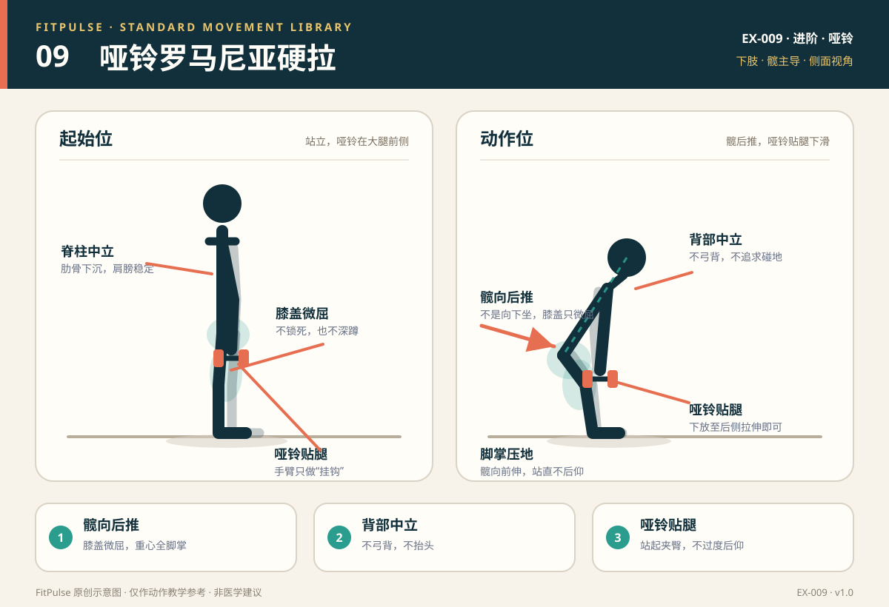

# 哑铃罗马尼亚硬拉

*图示：左为站立持哑铃起始位，右为髋部后推、哑铃贴腿下放；仅作教学示意。*

## 一句话要点

膝盖微屈、髋向后推，哑铃贴着腿下滑；背部中立，感到大腿后侧拉伸后用臀腿站起。

## 目标肌群与发力感

- **主要**：腘绳肌、臀大肌。
- **次要**：竖脊肌、内收肌群、前臂肌群。
- **发力感**：下放时大腿后侧有明显拉伸，站起时臀部和大腿后侧发力；腰部保持稳定，不应出现弓背或顶端过度后仰。

## 器械、场地与适用人群

- **器械**：一对哑铃；也可先用一根木棍/扫帚柄练习髋铰链。
- **场地**：约 2 平方米的平整地面。
- **适用**：已掌握徒手髋铰链、想训练后链的人；希望改善臀部与腘绳肌力量的新手。
- **先评估**：急性腰痛或腿麻、急性腘绳肌拉伤、无法保持脊柱中立、近期脊柱/髋部手术的人。

## 标准动作

### 起始位

1. 双脚与髋同宽，脚尖朝前或轻微外展；膝盖微屈，不锁死。
2. 双手持哑铃置于大腿前侧，掌心朝向身体；肩膀向后下方稳定。
3. 肋骨下沉，腹部轻收，脊柱保持中立；视线看向前下方。

### 动作过程

1. 吸气，髋部向后推，膝盖保持微屈，躯干随之前倾。
2. 哑铃贴着大腿前侧向下滑，接近小腿；小腿尽量保持接近垂直。
3. 保持背部中立，下放到大腿后侧有明显拉伸、背部仍能保持中立的位置；通常躯干与地面约 30°–45°，因人而异。
4. 呼气，脚掌压地，髋部向前伸，臀腿发力站起；顶端站直即可，不要过度后仰。

### 结束与节奏

- 下放 3 秒 → 最低点停 0–1 秒 → 站起 1–2 秒。
- 哑铃始终贴近身体；如果哑铃远离小腿，说明髋铰链变成了“弯腰拿重物”。
- 每组结束后重新建立呼吸和脊柱中立，再开始下一次。

## 呼吸

下放时吸气，站起时呼气。可在下放前轻轻绷紧腹部建立支撑；不要长时间憋气。

## 关键对齐要点

| 部位 | 标准 | 快速自查 |
|---|---|---|
| 脊柱 | 从头到尾保持中立，不弓背、不塌腰 | 下放时背是否变圆？ |
| 髋部 | 向后推，而不是向下蹲 | 髋是否向后移动、臀部有拉伸感？ |
| 膝盖 | 微屈且稳定，不锁死 | 膝盖是否过度弯曲，变成深蹲？ |
| 哑铃 | 贴近大腿和小腿下滑 | 哑铃是否远离身体、向前漂？ |
| 小腿 | 接近垂直，重心在全脚掌 | 脚跟是否离地、重心跑到脚尖？ |
| 头颈 | 视线前下方，颈部与脊柱同线 | 是否抬头、下巴前伸？ |

## 常见错误与纠正

| 错误 | 典型表现 | 纠正方法 |
|---|---|---|
| 弓背 | 下放时上背圆、腰椎屈曲 | 降低重量和幅度；先把髋向后推，保持胸骨朝前；用木棍贴背练习脊柱中立 |
| 做成深蹲 | 膝盖大幅前移，髋部向下坐 | 提示“髋向后、膝盖微屈”；面对墙练习髋铰链，膝盖不碰墙 |
| 哑铃远离身体 | 哑铃向前漂，腰部压力增加 | 让哑铃贴着腿下滑；肩胛稳定，手臂只做“挂钩” |
| 顶端过度后仰 | 站起时腰向后折、肋骨外翻 | 站直即可；顶端夹臀但不过度挺腰；收肋骨 |
| 下放过深 | 为了碰地而弓背或膝盖过度弯 | 以背部中立和大腿后侧拉伸为上限；不必追求哑铃碰地 |
| 抬头 | 下放时抬头看镜子，颈椎过伸 | 视线看向前下方；保持头颈与脊柱同线 |

## 新手组次建议

- **频率**：每周 2 次，放在下肢训练日中。
- **组数 × 次数**：2–3 组 × 8–12 次。
- **重量选择**：新手可从每只 2–5 公斤开始；以能保持背部中立、哑铃贴腿为准。
- **组间休息**：60–90 秒。
- **进阶标准**：连续两次训练都能在背部中立的前提下完成 12 次，再增加重量或改为单腿版本。

## 降阶与进阶

- **降阶**：徒手髋铰链；木棍贴背练习；只做半程；更轻的哑铃；面对墙限制膝盖前移。
- **进阶**：增加重量；3 秒离心；单腿罗马尼亚硬拉；在动作稳定后加入停顿。
- 单腿版本对平衡和骨盆稳定要求更高，先从扶墙开始。

## 安全提示

- 选择自己能稳定控制的重量；不要用腰部“甩”起来。
- 在镜子侧面或用手机录像检查背部是否保持中立。
- 出现腰痛、腿麻、放射痛或腘绳肌撕裂感时停止。
- 本条目是教学信息，不构成医疗建议。

## 常见问题

**Q：罗马尼亚硬拉和普通硬拉有什么区别？**  
A：罗马尼亚硬拉从站立位开始，膝盖弯曲较少，强调髋铰链和腘绳肌拉伸；普通硬拉从地面开始，膝盖参与更多。两者不是同一个动作，不能直接用同一个重量。

**Q：下放时腰酸，怎么办？**  
A：先检查是否弓背、哑铃远离身体或下放过深。降低重量和幅度，保持髋向后推、胸骨朝前；用木棍贴背练习。若伴随腿麻或放射痛，应停止并评估。

**Q：哑铃一定要碰到地面吗？**  
A：不需要。下放到大腿后侧有明显拉伸、背部仍能保持中立即可。为了碰地而弓背或过度屈膝，反而偏离训练目标。

## 知识出处

- [S2] NSCA's Essentials of Strength Training and Conditioning, 4th ed.（髋铰链与后链训练）
- [S3] ACE Exercise Library（罗马尼亚硬拉技术要点与常见错误）
- [S4] ExRx Exercise Directory（腘绳肌与臀大肌参与）

完整书目与访问日期见 [SOURCES.md](../SOURCES.md)。

> 本条目由 FitPulse 团队整理，用于教学参考，不替代医生或线下教练的个体化评估。
