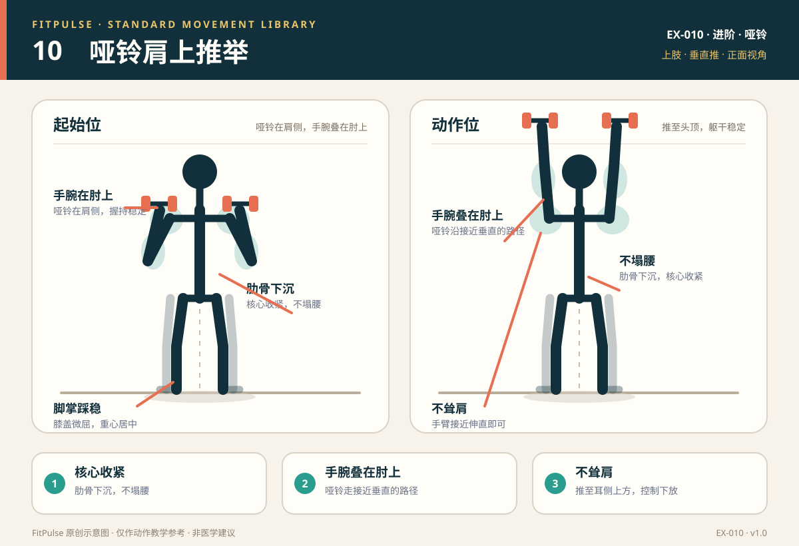

# 哑铃肩上推举

*图示：左为哑铃在肩侧的起始位，右为过顶推起位；仅作教学示意。*

## 一句话要点

肋骨下沉、核心收紧，哑铃从肩侧推到头顶；手腕叠在肘上，不塌腰、不耸肩。

## 目标肌群与发力感

- **主要**：三角肌前束、三角肌中束、肱三头肌。
- **次要**：上胸大肌、斜方肌上束、核心肌群。
- **发力感**：推起时肩膀和手臂后侧发力，核心保持稳定；腰部不应出现明显挤压，肩膀不应向耳朵耸起。

## 器械、场地与适用人群

- **器械**：一对哑铃；可坐在有靠背的稳固椅子上完成退阶。
- **场地**：约 2 平方米，头顶上方留出足够空间。
- **适用**：已有一定上肢力量、想训练肩部推力的人；居家哑铃训练。
- **先评估**：急性肩、颈、腕损伤；过顶时肩痛或卡顿；近期肩部手术。

## 标准动作

### 起始位

1. 站立或坐在有靠背的椅子上，双脚踩稳，膝盖微屈。
2. 双手持哑铃置于肩侧，手腕位于肘关节上方；掌心朝前或相对，选择肩部舒适的方式。
3. 肋骨下沉，腹部轻收，肩胛骨稳定；不要为了托住哑铃而塌腰或耸肩。

### 动作过程

1. 呼气，双手向头顶上方推起，哑铃沿接近垂直的路径移动。
2. 推到手臂接近伸直、肱二头肌靠近耳朵的位置；手腕保持在肘上方。
3. 保持肋骨下沉和核心收紧，不要用腰部后仰来“借空间”。
4. 吸气，用 2–3 秒有控制地下降到肩侧或耳朵高度，重复。

### 结束与节奏

- 推起 1–2 秒 → 顶端停 0–1 秒 → 下放 2–3 秒。
- 顶端不需要把肩膀耸到耳朵，也不要把肘关节锁死到不适。
- 每组结束后把哑铃放回肩侧或安全放下，不要直接甩落。

## 呼吸

推起时呼气，下放时吸气。核心保持轻微收紧；不要憋气到头晕，也不要在顶端放松腹部。

## 关键对齐要点

| 部位 | 标准 | 快速自查 |
|---|---|---|
| 肋骨与骨盆 | 肋骨下沉，骨盆中立 | 推起时肋骨是否向前顶、腰是否后仰？ |
| 手腕与肘 | 手腕叠在肘上方 | 手腕是否折向一侧或落在肘后？ |
| 肩胛 | 随手臂向上旋转，不耸肩 | 肩膀是否向耳朵靠近？ |
| 头颈 | 中立，视线前方 | 是否抬头过度、下巴前伸？ |
| 核心 | 腹部轻收，躯干稳定 | 是否用腰部反弓来完成动作？ |
| 膝盖 | 微屈，脚掌踩稳 | 是否膝盖锁死、重心前后晃？ |

## 常见错误与纠正

| 错误 | 典型表现 | 纠正方法 |
|---|---|---|
| 腰部后仰 | 推起时腰向前顶、肋骨外翻 | 降低重量；收肋骨、夹臀，保持核心收紧；可先坐姿靠背完成 |
| 耸肩 | 肩膀向耳朵靠近，颈部紧张 | 推起前先让肩胛骨稳定；不要把“推高”变成“耸肩”；降低重量 |
| 手腕折叠 | 手腕向后或向侧弯，握持不稳 | 让哑铃重心落在前臂上方；手腕保持中立；必要时改用中立握 |
| 向前推 | 哑铃跑到身体前方，肩前侧压力大 | 让哑铃沿接近垂直的路径移动；手腕在肘上方；降低重量 |
| 半程动作 | 只推到额头或眼睛高度 | 降低重量，完成可控的过顶范围；以肩部无痛为前提 |
| 肘部过度向后 | 起始位肘关节落在身体后方 | 把肘略微向前收，手腕叠在肘上；选择舒适握法 |

## 新手组次建议

- **频率**：每周 2 次，作为上肢推力训练的一部分。
- **组数 × 次数**：2–3 组 × 8–12 次。
- **重量选择**：新手可从每只 1–4 公斤开始；以能保持肋骨下沉、不过度后仰为准。
- **组间休息**：60–90 秒。
- **进阶标准**：连续两次训练都能在躯干稳定、肩部无痛的前提下完成 12 次，再增加重量或改为站姿。

## 降阶与进阶

- **降阶**：坐姿靠背推举；单臂交替推举；更轻的哑铃；地雷管推举（若有器械）；先做肩胛控制和肩部活动度练习。
- **进阶**：站姿推举；增加重量；3 秒离心；半跪姿单臂推举。
- 不建议做颈后推举；对肩关节要求更高，且不适合作为新手默认动作。

## 安全提示

- 确认头顶上方没有吊灯、柜门等障碍物；哑铃要握稳。
- 肩部出现尖锐疼痛、卡顿、无力或放射到手臂的麻木时停止。
- 不要把腰部后仰当作“活动度”；如果过顶受限，先评估肩胛和胸椎活动度。
- 本条目是教学信息，不构成医疗建议。

## 常见问题

**Q：站着推和坐着推，哪个更好？**  
A：都可以。坐姿靠背能减少腰部代偿，适合新手先建立肩部推力；站姿需要更多核心稳定。若腰部容易后仰，先坐姿；若想训练整体稳定，再过渡到站姿。

**Q：哑铃应该推到多高？**  
A：推到手臂接近伸直、肱二头肌靠近耳朵即可，不必强行锁死肘关节。前提是肋骨下沉、腰部不过度后仰、肩部无痛。

**Q：推举时肩膀疼怎么办？**  
A：先停止过顶动作，降低重量或改为坐姿，并检查手腕是否在肘上、是否耸肩、是否过度后仰。若疼痛持续、卡顿或伴无力/麻木，应找医生或康复师评估。

## 知识出处

- [S2] NSCA's Essentials of Strength Training and Conditioning, 4th ed.（过顶推举技术与肩带稳定）
- [S3] ACE Exercise Library（肩推技术要点与常见错误）
- [S4] ExRx Exercise Directory（三角肌与肱三头肌参与）

完整书目与访问日期见 [SOURCES.md](../SOURCES.md)。

> 本条目由 FitPulse 团队整理，用于教学参考，不替代医生或线下教练的个体化评估。
