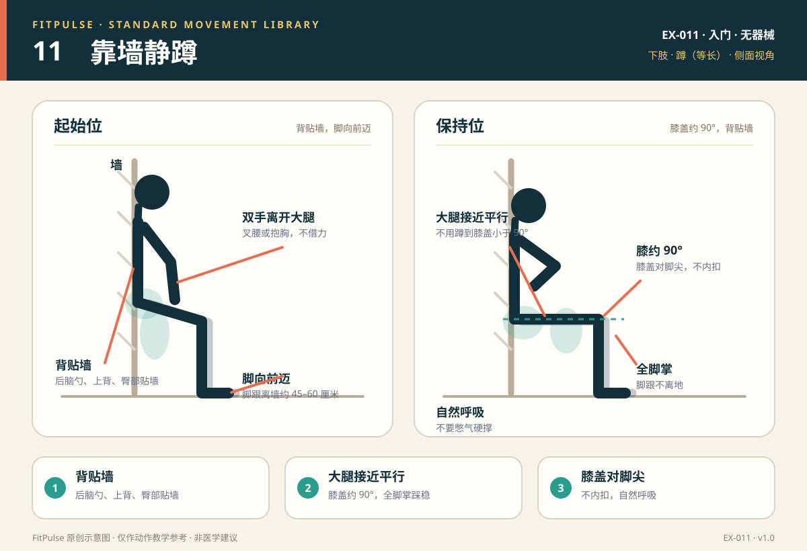

# 靠墙静蹲

*图示：左为背贴墙站立起始位，右为屈膝约 90° 的保持位；仅作教学示意。*

## 一句话要点

背贴墙，脚向前迈出，滑到膝盖约 90°；膝盖对脚尖，全脚掌踩稳，自然呼吸。

## 目标肌群与发力感

- **主要**：股四头肌、臀大肌。
- **次要**：腘绳肌、小腿肌群、核心肌群。
- **发力感**：大腿前侧持续发力，臀部参与稳定；膝盖前侧应稳定，不应出现尖锐疼痛。靠墙静蹲是等长训练，不需要“越久越抖”才算有效。

## 器械、场地与适用人群

- **器械**：无；需要一面平整、干净的墙。
- **场地**：约 1–2 平方米，墙前留出脚向前迈的空间。
- **适用**：想训练下肢耐力、刚开始接触力量训练的新手；膝关节稳定、无痛的人；作为深蹲的辅助动作。
- **先评估**：急性膝/髋/踝损伤；屈膝时膝前疼痛；近期下肢手术。

## 标准动作

### 起始位

1. 背贴墙站立，双脚与肩同宽，脚跟离墙约 45–60 厘米。
2. 后脑勺、上背和臀部贴墙，肋骨下沉，腹部轻收。
3. 双手叉腰或抱在胸前，不要用手撑大腿。

### 动作过程

1. 呼气，沿墙缓慢下滑，直到大腿接近平行地面、膝盖约 90°。
2. 膝盖与脚尖同向，不向内夹；全脚掌踩地，脚跟不离地。
3. 背部贴墙，腰部不要离开墙面形成大空隙；保持自然呼吸。
4. 保持到预定时间或大腿前侧明显疲劳，但动作仍稳定。

### 结束与节奏

- 呼气，脚掌推地，沿墙滑回站立；不要突然松劲坐下。
- 每组 20–45 秒，组间休息 30–45 秒；新手从 20 秒开始。
- 如果膝盖或腰部不适，升高身体位置（屈膝角度更大）或缩短时间。

## 呼吸

保持平稳呼吸，不要憋气。可用“吸气 3 秒、呼气 3 秒”的节奏；如果无法自然呼吸，说明保持时间过长或位置过低。

## 关键对齐要点

| 部位 | 标准 | 快速自查 |
|---|---|---|
| 背部 | 后脑勺、上背、臀部贴墙 | 腰是否离开墙面很多？ |
| 膝关节 | 约 90°，与脚尖同向 | 膝盖是否内扣或超过脚尖太多？ |
| 足部 | 全脚掌踩地，脚跟不离地 | 是否脚尖抓地、脚跟抬起？ |
| 大腿 | 接近平行地面 | 是否蹲得太高或太低？ |
| 双手 | 离开大腿，叉腰或抱胸 | 是否用手撑腿借力？ |
| 呼吸 | 自然、连续 | 是否憋气、脸红？ |

## 常见错误与纠正

| 错误 | 典型表现 | 纠正方法 |
|---|---|---|
| 脚离墙太近 | 膝盖前冲、脚跟离地、膝前压力大 | 把脚向前多迈 5–10 厘米；让小腿接近垂直；必要时升高身体位置 |
| 膝盖内扣 | 两膝向中间靠，足弓塌 | 膝盖向小脚趾方向分开；缩小屈膝角度；先做臀中肌激活 |
| 腰离墙 | 腰部拱起，离开墙面 | 收肋骨、轻收腹部；不要为了“蹲低”而把腰向前顶 |
| 用手撑大腿 | 双手压腿借力 | 双手叉腰或抱胸；降低难度或缩短时间 |
| 憋气 | 脸憋红、结束后头晕 | 保持自然呼吸；缩短保持时间；不要用憋气硬撑 |
| 蹲得过低 | 膝盖角度小于 90°，膝前压力大 | 升高身体位置，保持大腿接近平行即可；以无痛为准 |

## 新手组次建议

- **频率**：每周 2–3 次，可作为下肢训练的热身或收尾。
- **组数 × 时长**：2–3 组 × 20–45 秒。
- **组间休息**：30–45 秒。
- **进阶标准**：连续两次训练都能在背部贴墙、膝盖不内扣、自然呼吸的前提下完成 45 秒，再考虑延长时间或增加难度。

## 降阶与进阶

- **降阶**：身体升高、屈膝角度更大；缩短到 10–20 秒；双手叉腰；背靠墙但不下滑太深。
- **进阶**：延长到 60 秒；单腿靠墙静蹲；在髋部放轻负重；与自重深蹲组合。
- 不建议用“抖到坚持不住”作为唯一目标；动作变形时应结束该组。

## 安全提示

- 选择平整、干燥的墙面和地面；穿防滑鞋或赤脚在防滑地面上做。
- 出现膝前尖锐疼痛、膝关节肿胀、腰部不适或头晕时停止。
- 靠墙静蹲不能替代完整的深蹲动作学习；它是等长辅助，不是唯一的下肢训练。
- 本条目是教学信息，不构成医疗建议。

## 常见问题

**Q：靠墙静蹲膝盖疼怎么办？**  
A：先把脚向前多迈一点，让小腿更接近垂直，并升高身体位置（不要蹲到 90°）；检查膝盖是否内扣、脚跟是否离地。若疼痛持续或伴肿胀，应停止并找医生或康复师评估。

**Q：靠墙静蹲可以每天做吗？**  
A：可以作为低强度活动每天做少量，但如果有明显肌肉疲劳，建议隔天或每周 2–3 次，让下肢恢复。不要每天做到力竭。

**Q：膝盖可以超过脚尖吗？**  
A：没有绝对禁令。靠墙静蹲时更重要的是全脚掌踩稳、膝盖与脚尖同向、背部贴墙且无痛。脚离墙太近会让膝盖过度前冲，脚离墙太远则可能让脚跟滑动；以稳定和舒适为准。

## 知识出处

- [S3] ACE Exercise Library（靠墙静蹲技术要点与常见错误）
- [S4] ExRx Exercise Directory（股四头肌与臀部参与）
- [S5] Mayo Clinic, Weight training: Do's and don'ts of proper technique（呼吸与受控技术）

完整书目与访问日期见 [SOURCES.md](../SOURCES.md)。

> 本条目由 FitPulse 团队整理，用于教学参考，不替代医生或线下教练的个体化评估。
