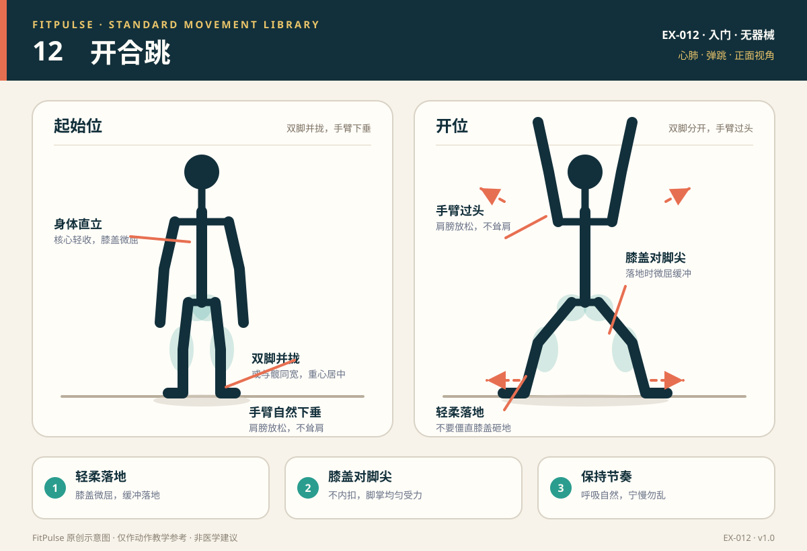

# 开合跳

*图示：左为并拢起始位，右为双脚分开、手臂过头的开位；仅作教学示意。*

## 一句话要点

轻跳开合，前脚掌/全脚掌柔和落地，膝盖对脚尖；手臂过头但肩膀放松。

## 目标肌群与发力感

- **主要**：小腿肌群、三角肌、臀中肌。
- **次要**：股四头肌、腘绳肌、核心肌群、肩袖肌群。
- **发力感**：小腿和臀部参与弹跳，肩部完成手臂上举；落地时应是“轻”的，不应有关节撞击感。心肺会快速上升，呼吸变快是正常的。

## 器械、场地与适用人群

- **器械**：无；防滑地面和运动鞋更合适。
- **场地**：约 3–4 平方米，头顶和两侧留出空间；宿舍楼需考虑楼下噪音。
- **适用**：想快速热身、提高心率的健康成人新手；时间少、需要低门槛有氧的人。
- **先评估**：急性踝/膝/髋损伤、明显平衡障碍、跳跃落地时关节不稳；有心肺疾病或运动中胸痛/眩晕史的人先咨询医生。

## 标准动作

### 起始位

1. 自然站立，双脚并拢或与髋同宽，双臂垂在身体两侧。
2. 膝盖微屈，腹部轻收，视线前方，身体直立。
3. 先做几次原地踏步，确认地面防滑、周围没有障碍物。

### 动作过程

1. 轻轻起跳，双脚向两侧分开到略宽于肩，同时双臂从身体两侧向上摆过头顶。
2. 前脚掌或全脚掌柔和落地，膝盖微屈缓冲，膝盖与脚尖同向。
3. 再次轻跳，双脚回到并拢/髋宽，双臂回落至身体两侧。
4. 保持均匀节奏，不要为了速度而僵硬落地。

### 结束与节奏

- 以 30 秒为一组，或按 20 秒运动/40 秒休息的间歇开始。
- 落地时想象“轻轻放下去”，而不是“砸下去”。
- 结束后原地慢走 1–2 分钟，让心率逐渐下降。

## 呼吸

保持自然、有节奏的呼吸，不要憋气。可以用“跳开时呼气、合拢时吸气”的节奏；若无法说话或呼吸过于急促，降低速度或改为踏步版本。

## 关键对齐要点

| 部位 | 标准 | 快速自查 |
|---|---|---|
| 落地 | 前脚掌/全脚掌柔和落地，膝盖微屈 | 落地声音是否很大、关节是否被震到？ |
| 膝关节 | 与脚尖同向，不内扣 | 落地时膝盖是否向中间靠？ |
| 躯干 | 直立，核心轻收 | 是否前后左右晃、塌腰？ |
| 手臂 | 从体侧摆到头顶，肩部放松 | 是否耸肩、手臂只摆到一半？ |
| 节奏 | 均匀、可控 | 是否越跳越快、动作变形？ |
| 呼吸 | 自然连续 | 是否憋气、头晕？ |

## 常见错误与纠正

| 错误 | 典型表现 | 纠正方法 |
|---|---|---|
| 僵硬落地 | 落地声音大、膝盖锁死、关节震感明显 | 降低跳跃高度；落地时屈膝缓冲；改为踏步开合 |
| 膝盖内扣 | 落地时两膝向中间靠 | 缩小开合幅度；提示膝盖对脚尖；先做侧向弹力带行走激活臀中肌 |
| 身体前后晃 | 核心放松，落地重心不稳 | 收紧腹部，缩小幅度；先做原地踏步和低冲击版本 |
| 手臂只摆一半 | 手臂停在肩高，肩部紧张 | 降低速度；让手臂完整摆过头顶但不过度耸肩；肩部活动度不足时先做肩部热身 |
| 越跳越快 | 节奏失控、呼吸急促 | 用节拍器或音乐控制节奏；采用间歇训练；每组时间缩短 |
| 憋气 | 脸红、头晕 | 保持自然呼吸；降低强度；若头晕持续，停止并休息 |

## 新手组次建议

- **频率**：每周 2–3 次，可作为热身或有氧间歇。
- **组数 × 时长**：3 组 × 20–30 秒，组间休息 30–60 秒。
- **进阶标准**：能保持轻盈落地、膝盖不内扣、呼吸可控，再延长时间或提高节奏。
- **宿舍替代**：step jack（踏步开合）或低冲击开合，减少跳跃和噪音。

## 降阶与进阶

- **降阶**：step jack（一只脚依次向侧迈出，不跳）；小幅度开合；去掉手臂过头；缩短到 15 秒。
- **进阶**：延长时间；加快节奏；半蹲开合跳；与其他低冲击有氧动作组合。
- 体重较大、膝踝不适或住在楼上时，优先选择低冲击版本，不需要勉强跳跃。

## 安全提示

- 选择防滑地面，穿有缓冲的运动鞋；清理周围障碍物。
- 落地时保持轻盈；出现膝、踝疼痛或关节不稳时停止。
- 运动中出现胸痛、眩晕、异常呼吸困难或心悸时立即停止，必要时就医。
- 宿舍内注意楼下噪音；可用踏步版本替代跳跃。
- 本条目是教学信息，不构成医疗建议。

## 常见问题

**Q：楼下邻居怕吵，能做开合跳吗？**  
A：可以改成 step jack：双脚交替向侧迈出，手臂同样上举，不跳跃；或者做小幅度、慢速的开合。训练效果会有所不同，但更适合宿舍环境。

**Q：开合跳膝盖疼怎么办？**  
A：先停止跳跃，改为踏步版本；检查落地是否僵硬、膝盖是否内扣。若疼痛持续、伴肿胀或关节不稳，应找医生或康复师评估。

**Q：开合跳能替代跑步吗？**  
A：它可以快速提高心率，但动作模式和能量消耗与跑步不同。作为热身、间歇或居家有氧的补充可以；若目标是跑步表现，仍需要专项跑步训练。

## 知识出处

- [S1] ACSM's Guidelines for Exercise Testing and Prescription, 11th ed.（心肺运动与安全筛查）
- [S3] ACE Exercise Library（开合跳技术要点与低冲击替代）

完整书目与访问日期见 [SOURCES.md](../SOURCES.md)。

> 本条目由 FitPulse 团队整理，用于教学参考，不替代医生或线下教练的个体化评估。
