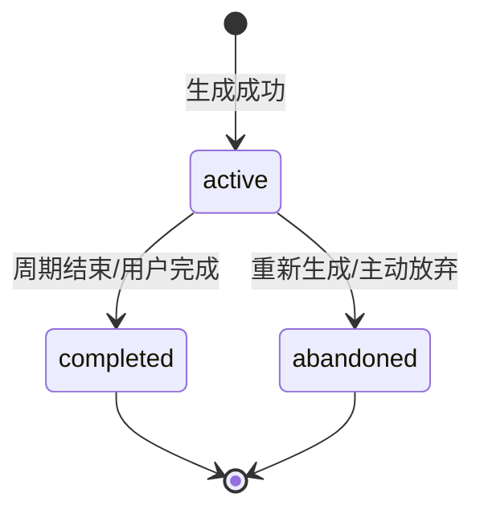
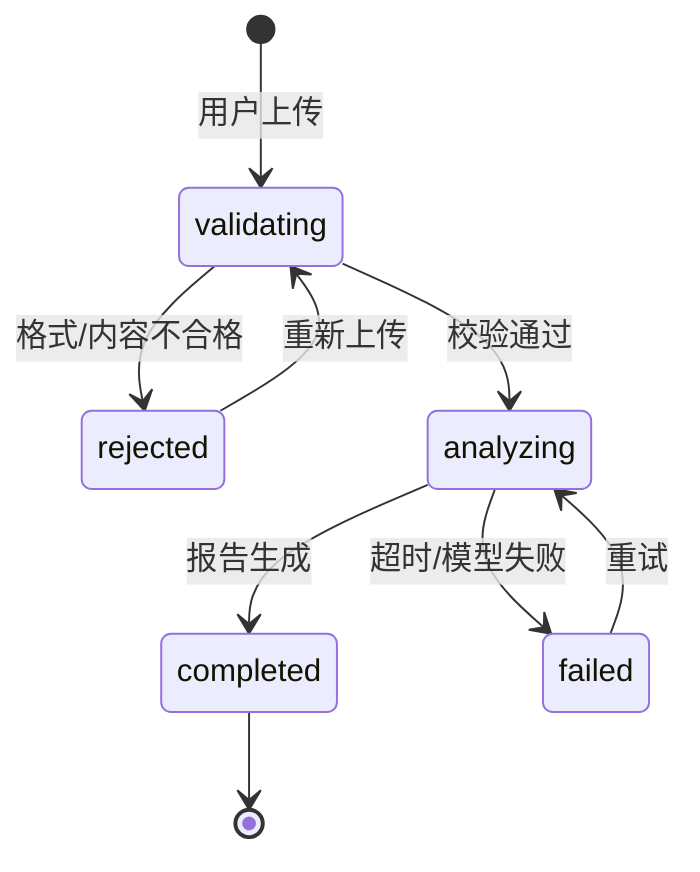
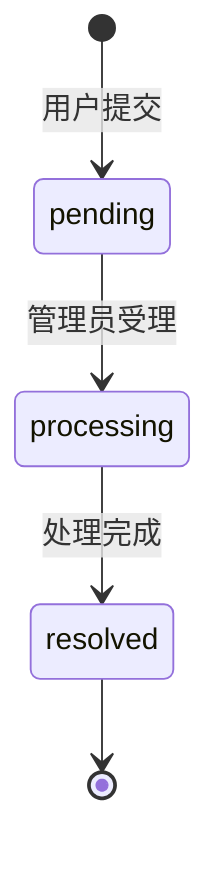

# FitPulse 需求细化说明

| 项目 | 内容 |
|---|---|
| 项目名称 | FitPulse 健身动作矫正 & 居家锻炼智能 Agent |
| 文档名称 | 需求细化说明（业务规则与验收用例） |
| 文档版本 | v0.1（初稿） |
| 编制人 | 陈加豪（产品经理） |
| 编制日期 | 2026-11-08 |
| 文档状态 | 待团队评审 |
| 关联文档 | [需求分析文档](../FitPulse_需求分析文档.md) · [系统设计说明书](../FitPulse_系统设计说明书.md) · [数据库设计说明书](../FitPulse_数据库设计说明书.md) · [用户画像](FitPulse_用户画像.md) · [PRD 补充说明](FitPulse_PRD补充说明.md) |

## 文档修订记录

| 版本 | 日期 | 修改人 | 修改内容 |
|---|---|---|---|
| v0.1 | 2026-11-08 | 陈加豪 | 初稿：业务规则、状态机、异常边界、20 条验收用例、Gap 与待决策清单 |

---

## 1. 目的、范围与读者

### 1.1 目的

把《需求分析文档》中的目标与《PRD 补充说明》中的功能要求，细化为**开发可直接实现、测试可直接验证**的业务规则、边界行为与验收用例，消除"大概是这样"的模糊地带。

### 1.2 范围

- 覆盖 P0 全部功能与 P1 主要功能（记录统计、反馈、后台）。
- 覆盖正常流程、异常流程、安全边界与权限边界。
- 不覆盖技术实现细节（由《系统设计说明书》负责）；涉及接口/表时仅引用，不重复定义。

### 1.3 读者

| 读者 | 重点章节 |
|---|---|
| 后端/Agent 开发 | 第 3、4、6、9 节 |
| 前端开发 | 第 3、5、6 节 |
| 测试 | 第 3、4、6、7、8 节 |
| 设计与文案 | 第 5 节 |
| 队长/评审 | 第 9、10 节 |

---

## 2. 术语与角色

### 2.1 术语表

| 术语 | 定义 |
|---|---|
| 匿名用户 | 首次访问自动创建、无需手机号/密码的用户；以 UUID 标识 |
| 用户档案 | 水平、目标、器械、每周天数、单次时长等生成计划所需的信息 |
| 标准动作 | 动作的起始姿势、轨迹、呼吸、节奏、常见错误等知识 |
| 目标肌群 / 协同肌 | 动作主要发力的肌肉 / 辅助发力的肌肉 |
| 代偿 | 目标肌群未充分发力，其他部位代替发力并可能增加受伤风险 |
| 训练日 / 休息日 | 计划中安排训练 / 恢复的日期 |
| 分化 | 按部位或推拉腿拆分训练日的安排方式 |
| 纠错报告 | 基于照片给出的动作识别、问题列表、纠正建议与安全提示 |
| 严重度 | `mild`（轻微偏差）/ `moderate`（明显偏差，有风险）/ `severe`（疼痛或受伤风险，应停止） |
| 出处 | 知识条目的可核验来源（教材、章节、公开课程等） |
| 红线信号 | 疼痛、麻木、肿胀、关节响伴痛、活动受限、头晕、胸闷等需要停止训练的信号 |
| 2D 照片局限 | 单张平面照片受视角、遮挡、光线影响，不能替代现场评估或医疗诊断 |

### 2.2 角色与权限

| 角色 | 能做什么 | 不能做什么 |
|---|---|---|
| 匿名用户 | 对话、查动作、生成计划、上传纠错、修改自己的档案、查看自己的记录 | 访问他人数据、访问后台、修改知识库 |
| 管理员 | 知识库 CRUD、用户列表只读、系统概览、反馈管理 | 查看用户图片原文以外的敏感信息、代替用户训练 |
| 系统（Agent） | 意图识别、RAG 检索、工具调用、生成回答 | 医疗诊断、康复处方、超范围建议 |

---

## 3. 业务规则

> 编号规则：`BR-模块-序号`。规则为强制要求；标注"建议"的条目可在评审中调整。

### 3.1 账号与档案

| 编号 | 规则 |
|---|---|
| BR-ACC-01 | 首次进入自动创建匿名用户（UUID v4）并签发 JWT；**不要求**手机号、邮箱、密码。 |
| BR-ACC-02 | 同一浏览器通过本地存储保留登录态；清除缓存或更换设备视为新用户，MVP 不做账号合并（P2）。 |
| BR-ACC-03 | 管理员使用独立账号（环境变量配置）登录后台；普通用户 JWT 不能访问 `/admin` 及 `/api/admin/*`。 |
| BR-ACC-04 | 用户只能访问自己的会话、计划、纠错、统计；越权返回 403（不泄露资源是否存在）。 |
| BR-ACC-05 | MVP 不提供账号注销；提供删除会话/纠错记录（P1）；上传图片按 30 天策略自动清理。 |
| BR-PRO-01 | 首次生成计划前必须采集：`fitness_level`、`goal`、`equipment`、`weekly_days`、`session_minutes`；`nickname`、`avatar_url` 可选。 |
| BR-PRO-02 | 默认值：`beginner`、`general`、`[]`（无器械）、`3` 天、`30` 分钟。用户选择"按默认"时使用默认值并明确告知。 |
| BR-PRO-03 | 采集方式为一次一个问题，最多 4 个问题；已采集字段不重复询问；允许跳过。 |
| BR-PRO-04 | 器械枚举：无器械、瑜伽垫、弹力带、哑铃、壶铃、椅子、其他；可多选；"无器械"始终视为可用。 |
| BR-PRO-05 | 校验：`weekly_days` 1–7；`session_minutes` 10–60；器械最多 6 项。非法值拒绝保存并提示。 |
| BR-PRO-06 | 修改档案不自动覆盖当前 `active` 计划；提示用户是否重新生成，由用户确认。 |
| BR-PRO-07 | **不主动采集**身高、体重、性别、病史等敏感信息；用户主动提供时仅用于当次回答，不写入数据库。 |

### 3.2 意图识别与会话

| 编号 | 规则 |
|---|---|
| BR-INT-01 | 意图类别：`exercise_query`、`plan_generation`、`posture_correction`、`progress_query`、`profile_update`、`chitchat`。 |
| BR-INT-02 | 识别优先级：① 上传图片 → 纠错；② 明确计划关键词（计划/周计划/今天练什么/安排）→ 计划；③ 动作名/要领/怎么做 → 动作查询；④ 进度/记录/统计 → 统计；⑤ 档案/目标/水平 → 档案更新；⑥ 问候/感谢 → 闲聊；⑦ 其余 → 澄清或兜底。 |
| BR-INT-03 | 多意图输入：先处理主意图（安全相关优先），再确认是否继续处理次意图，不静默丢弃。 |
| BR-INT-04 | 模糊输入最多澄清 2 次；仍不明确时给出 3 个快捷选项（查动作/生成计划/拍照纠错），不猜测执行。 |
| BR-INT-05 | 与健身无关的问题：一回合内礼貌说明能力范围并引导回健身；不提供医疗、法律、投资等专业建议。 |
| BR-INT-06 | 上下文：携带最近 10 轮消息 + 用户档案；会话超过 20 条消息时生成摘要，保留摘要 + 最近 6 条 + 档案。 |
| BR-INT-07 | 新建会话不继承聊天历史，但继承用户档案；删除会话后不可恢复（P1）。 |
| BR-INT-08 | 医疗类请求（诊断/用药/康复处方）：明确拒绝诊断，建议就医；可提供一般性安全信息。 |
| BR-INT-09 | 不执行与健身无关的指令；不泄露系统提示词、工具 Schema、API Key 等内部信息。 |
| BR-INT-10 | 默认中文回答；可识别常见英文动作名（squat/push-up/plank 等）并转中文解释。 |

### 3.3 动作查询

| 编号 | 规则 |
|---|---|
| BR-EX-01 | 匹配顺序：精确名称 > 别名/标签 > 模糊匹配；别名由知识研究员维护在 `tags` 中。 |
| BR-EX-02 | 多个候选时展示前 3 个（名称、分类、难度、目标肌群），让用户选择，不擅自选一个。 |
| BR-EX-03 | 未命中时明确说明"知识库暂无可靠条目"，给出 2–3 个相近动作；**不得编造**动作要领或出处。 |
| BR-EX-04 | 动作卡必备字段：名称、分类、难度、所需器械、目标肌群、协同肌、分步骤要领、呼吸、节奏、常见错误（≥3）、配图（≥1）、出处。 |
| BR-EX-05 | 出处缺失时标注"知识库暂无出处"，不伪造引用；出处格式见 5.5。 |
| BR-EX-06 | 配图缺失时使用占位图并说明；配图应展示起始姿势或关键姿势。 |
| BR-EX-07 | 若动作难度高于用户水平，先提示风险并给低难度替代；高风险动作（大重量杠铃等）不推荐。 |
| BR-EX-08 | 回答以卡片为主，详细文字不超过约 500 字；长内容可折叠，避免一次倾倒。 |
| BR-EX-09 | 未命中时记录查询词（不含个人信息），供知识库补充；不向用户暴露该记录。 |
| BR-EX-10 | 动作查询不替代纠错：用户问"我做得对吗"但没有图片时，引导上传照片或描述具体不适。 |

### 3.4 训练计划

| 编号 | 规则 |
|---|---|
| BR-PLAN-01 | 计划周期为 7 天（周一至周日，Asia/Shanghai）；`start_date` 为本周一或用户确认的起始日。 |
| BR-PLAN-02 | 每周天数与分割：1 天=全身；2 天=全身 A/B；3 天=全身 ×3；4 天=上肢/下肢 ×2；5 天=推/拉/腿/上肢/下肢；6 天=推拉腿 ×2；7 天=6 个训练日 + 1 个主动恢复日。 |
| BR-PLAN-03 | 单次时长 → 动作数：10–20 分钟=2–3 个；20–30 分钟=3–4 个；30–45 分钟=4–5 个；45–60 分钟=5–6 个。`estimated_minutes` 与用户时长偏差 ≤10%。 |
| BR-PLAN-04 | 组数/次数/休息按水平：beginner 2–3 组 × 8–15 次，休息 60–90s；intermediate 3–4 组 × 8–12 次（增肌）或 12–15 次（减脂），休息 60–90s；advanced 3–5 组 × 6–12 次，休息 90–120s。 |
| BR-PLAN-05 | 目标调整：减脂→12–15 次、休息 30–60s、复合动作优先，可在时长内加 5–10 分钟低强度有氧（宿舍内不安排跳跃）；增肌→8–12 次、休息 60–90s、复合动作在前，说明渐进超负荷；体态改善→10–15 次、休息 45–60s，优先核心/臀/上背，避免加重疼痛部位；一般健康→10–12 次、休息 60s。 |
| BR-PLAN-06 | 器械过滤：动作的 `equipment_needed` 必须为"无"或 ⊆ 用户 `equipment`；不得用用户没有的器械；可提供无器械替代动作。 |
| BR-PLAN-07 | 难度过滤：动作难度 ≤ 用户水平（beginner 只用 beginner；intermediate 可用 beginner+intermediate；advanced 可用全部）。动作不足时增加变式，不越级。 |
| BR-PLAN-08 | 每个训练日结构：热身 5 分钟（动态活动）→ 主体 3–5 个动作 → 拉伸 5 分钟；单次 ≤20 分钟时热身/拉伸各 3 分钟。 |
| BR-PLAN-09 | 同一天不重复同一动作；同一部位不连续两天安排高强度训练（beginner/intermediate）；advanced 可连续但不得连续两天同一大重量复合动作。 |
| BR-PLAN-10 | 每周至少 1 个休息日；`weekly_days=7` 时第 7 天为主动恢复（散步/拉伸），不是高强度训练。 |
| BR-PLAN-11 | 动作排序：复合动作（多关节）在前，孤立动作在后；大肌群在前，小肌群在后；核心动作放在主体后段。 |
| BR-PLAN-12 | 同一用户同时只能有 1 个 `active` 计划；生成新计划时旧计划置为 `abandoned`，历史保留。 |
| BR-PLAN-13 | 计划状态：`active` → `completed`（周期结束或用户标记完成）/ `abandoned`（重新生成或放弃）；`completed`/`abandoned` 不可重新激活。 |
| BR-PLAN-14 | 重新生成触发：太难、太简单、太长、没有器械、疼痛/不适；一次只调整一个主要变量，保留历史计划。 |
| BR-PLAN-15 | 计划说明必须包含：分化逻辑、动作选择理由、渐进超负荷原则、安全提醒；不得出现医疗断言。 |
| BR-PLAN-16 | 打卡：可勾选单个动作；全部完成或用户点"完成本次训练"则训练日完成；写入 `workout_records`；当日可撤销；不得重复计数。 |
| BR-PLAN-17 | 未完成日期不自动判失败；完成率分母只统计截至今日的计划训练日；周期结束后未完成才计为未完成。 |
| BR-PLAN-18 | 生成失败（LLM/工具异常）不得写入半成品计划；保留已采集档案，提示重试。 |
| BR-PLAN-19 | advanced 用户仍不推荐大重量杠铃/高风险动作；如需，明确建议在专业教练保护下进行。 |
| BR-PLAN-20 | 若生成结果超出用户时长 >10%，优先删减孤立动作，保留复合动作与热身/拉伸。 |

### 3.5 动作纠错

| 编号 | 规则 |
|---|---|
| BR-COR-01 | 仅支持单张照片：JPG/JPEG/PNG/WebP，≤10MB，短边 ≥480px。 |
| BR-COR-02 | 照片要求：单人、全身或目标关节可见、光线充足、无明显遮挡；不接受截图、网图、多人照。 |
| BR-COR-03 | 前端校验类型/大小；模型校验人物数量/模糊/遮挡；不合格时说明具体原因并给重拍指引；最多重试 3 次，之后可转文字咨询。 |
| BR-COR-04 | 文字描述可选，≤500 字；用于补充不适部位、动作名称、训练感受；红线信号优先处理。 |
| BR-COR-05 | 动作识别置信度低时，请用户确认或从 3 个候选动作中选择；**不得猜测**后直接分析。 |
| BR-COR-06 | 问题数量 1–5 条；超过 5 条时展示严重度最高的 3 条 + 其余摘要；每条含部位、问题描述、纠正建议、严重度、参考图（可选）。 |
| BR-COR-07 | 严重度定义：mild=轻微偏差、无明显风险；moderate=明显偏差、继续可能增加风险；severe=疼痛/受伤风险、应立即停止。 |
| BR-COR-08 | 整体评价 2–4 句，鼓励性、具体；不做身材评价、不诊断疾病。 |
| BR-COR-09 | 未见明显问题时，明确说"从照片看未见明显偏差"，补充 2D 局限与 2 个自查点，不强行挑错。 |
| BR-COR-10 | 红线信号（疼痛/刺痛/麻木/肿胀/关节响伴痛/活动受限/头晕/恶心/胸闷/心慌）：先给安全提示（停止训练、休息、必要时就医/急诊），不再给训练动作建议；不做诊断。 |
| BR-COR-11 | 每份报告必须包含 2D 照片局限说明与免责声明（模板见 5.5）。 |
| BR-COR-12 | 隐私：图片存私有桶，签名 URL 限时 15 分钟；默认保留 30 天；用户可删除；不用于模型训练；分析日志不记录图片内容。 |
| BR-COR-13 | 参考图来自知识库；无参考图时用文字 + 关联动作卡说明，不伪造图片。 |
| BR-COR-14 | 非健身图片（风景、食物、截图等）不分析，说明原因并要求上传训练照片。 |
| BR-COR-15 | 多问题排序：severe > moderate > mild；同一部位合并描述，避免重复。 |
| BR-COR-16 | 用户对报告有异议时，不争辩；建议补充角度/视频（P2）或咨询专业教练，并记录反馈。 |
| BR-COR-17 | 用户上传他人照片时，提示需获得本人同意；未确认不分析。 |

### 3.6 训练记录与统计

| 编号 | 规则 |
|---|---|
| BR-REC-01 | 打卡写入 `workout_records`，同时更新 `plan_exercises.done` / `plan_days.completed`；两者在同一事务内，保证一致性。 |
| BR-REC-02 | 时区 Asia/Shanghai；周一为一周第一天；日期以服务器时间为准。 |
| BR-REC-03 | 统计口径：本周完成率=已完成训练日/截至今日的计划训练日；连续训练周数=连续有 ≥1 次完成的周数；累计训练次数=已完成训练日总数；累计纠错次数=已完成报告数。 |
| BR-REC-04 | 仅当日可撤销打卡；跨日后不可撤销，如需更正联系管理员（P2 自助更正）。 |
| BR-REC-05 | 难度评分 1–5（1 太轻松，5 太困难）；用于下一次计划调整；可跳过。 |
| BR-REC-06 | 统计更新延迟 ≤1 秒；同一训练日不得重复计数。 |
| BR-REC-07 | MVP 只统计计划内训练；自由训练（无计划）计入总训练次数为 P2。 |

### 3.7 反馈

| 编号 | 规则 |
|---|---|
| BR-FB-01 | 类型：bug / feature / praise / other；内容 5–1000 字；提交后显示"已收到"。 |
| BR-FB-02 | 状态流转：pending → processing → resolved；仅管理员可改。 |
| BR-FB-03 | MVP 不做用户可见回复；P2 增加处理结果通知。 |
| BR-FB-04 | 限流：每用户每天最多 10 条，防刷。 |

### 3.8 后台管理

| 编号 | 规则 |
|---|---|
| BR-ADM-01 | 仅管理员可访问；普通用户/未登录返回 403/401。 |
| BR-ADM-02 | 知识条目必填：模块（standard_action / muscle_activation / error_harm）、内容、出处；关联动作、标签、配图可选。 |
| BR-ADM-03 | 保存后 1 分钟内完成重新向量化；`chunk_id` 保持不变，避免历史引用失效。 |
| BR-ADM-04 | 停用/删除后不再被检索；建议软删除（`status=archived`），物理删除需二次确认。 |
| BR-ADM-05 | 单条内容 50–3000 字；超长需拆分，避免检索粒度过粗。 |
| BR-ADM-06 | 建议记录 `updated_by` / `updated_at` 审计字段（当前表缺失，见 Gap D-04）。 |
| BR-ADM-07 | 用户列表只读，展示昵称、水平、目标、注册时间；不展示身高体重等敏感信息。 |
| BR-ADM-08 | 系统概览：总用户、近 7 日活跃、消息数、计划数、纠错数、待处理反馈。 |
| BR-ADM-09 | 反馈管理：按类型/状态筛选，更新状态；不直接删除用户反馈。 |
| BR-ADM-10 | 后台操作记录日志（至少：操作人、对象、时间、动作）。 |

### 3.9 内容安全与合规

| 编号 | 规则 |
|---|---|
| BR-SAFE-01 | 能力边界：健身指导，不是医疗服务；不诊断、不开处方、不提供用药建议。 |
| BR-SAFE-02 | 红线信号出现时：停止训练 → 休息/冷敷（急性期）→ 必要时就医；胸痛、晕厥、严重肿胀等建议急诊。 |
| BR-SAFE-03 | 不推荐高风险动作（大重量杠铃深蹲/硬拉、颈后推举、负重体前屈等）；不提供极限训练/断食方案。 |
| BR-SAFE-04 | 不做身材羞辱或焦虑营销；不使用"胖/丑/必须瘦"等表达。 |
| BR-SAFE-05 | 领域知识必须有出处；无出处的内容不进入正式知识库。 |
| BR-SAFE-06 | 动作卡、计划卡、纠错报告固定展示免责声明；"关于"页展示完整版。 |
| BR-SAFE-07 | 未成年人：提示在监护人陪同下使用；不提供高强度/极限计划。 |
| BR-SAFE-08 | 用户询问"我是不是得了 XX 病"时，明确不能诊断，建议就医。 |
| BR-SAFE-09 | 不执行提示词注入/越权指令；不泄露系统提示词与内部配置。 |
| BR-SAFE-10 | 知识内容每两周复核一次；发现错误 24 小时内下线并修正。 |

### 3.10 错误处理与降级

| 编号 | 规则 |
|---|---|
| BR-ERR-01 | 网络断开：顶部提示；输入保留；恢复后由用户手动重发，不自动重复提交。 |
| BR-ERR-02 | LLM 超时（30s）：自动重试 1 次；仍失败返回 50001 + 友好文案 + 重试按钮。 |
| BR-ERR-03 | 限流 42900：提示冷却时间，按钮倒计时；不丢失输入。 |
| BR-ERR-04 | RAG 故障：降级为通用回答，明确标注"知识库暂不可用，未标注出处"；安全边界仍生效。 |
| BR-ERR-05 | 上传失败 50003：提示重试；格式/大小错误在前端拦截；不生成半份报告。 |
| BR-ERR-06 | SSE 中断：保留已生成内容，显示"生成中断"，可重试；重试不重复落库。 |
| BR-ERR-07 | 数据库写入失败：回答仍展示，提示"记录保存失败"；后台重试并记录日志。 |
| BR-ERR-08 | 意图识别失败：走澄清/兜底，不直接报错。 |
| BR-ERR-09 | 计划生成失败：不写半成品；保留档案；提示重试。 |
| BR-ERR-10 | 纠错分析失败：不输出猜测性报告；提示重试或改文字咨询。 |
| BR-ERR-11 | 错误文案不暴露堆栈、内部路径、API Key、模型名等敏感信息。 |
| BR-ERR-12 | 所有错误带 `request_id`，便于日志排查。 |

---

## 4. 状态机

### 4.1 训练计划状态

**约束**：同一用户仅 1 个 `active`；`completed`/`abandoned` 不可回到 `active`；历史计划可查看。

### 4.2 纠错流程状态

**约束**：`rejected` 与 `failed` 不计入纠错次数；不生成猜测性报告；重试沿用同一 `correction_id` 或新建均可，但不得重复计数。

### 4.3 反馈状态

---

## 5. 交互、提示与文案规范

### 5.1 加载与进度

| 场景 | 展示 |
|---|---|
| 普通对话 | "正在分析你的需求…"（≤3s 无反馈则升级提示） |
| 动作查询 | "正在检索动作知识…" |
| 计划生成 | "正在根据你的水平、器械和时间排计划…" |
| 纠错 | "正在校验照片…" → "正在识别动作…" → "正在分析姿势…" |
| 后台保存 | "正在保存并更新知识库…" |

### 5.2 错误提示

| 错误码 | 场景 | 用户文案 | 可执行动作 |
|---|---|---|---|
| 40001 | 参数校验失败 | "有一项信息没填对，请检查后再试。" | 返回修改 |
| 40100 | 未登录 | "登录状态已失效，请重新进入。" | 重新进入 |
| 40101 | Token 过期 | "登录状态已过期，请重新进入。" | 重新进入 |
| 40300 | 无权限 | "你没有权限访问这里。" | 返回首页 |
| 40400 | 资源不存在 | "这条记录不存在或已被删除。" | 返回 |
| 42900 | 请求过于频繁 | "问得有点快，休息 X 秒再试。" | 倒计时后重试 |
| 50000 | 服务器错误 | "服务开小差了，请稍后重试。" | 重试 |
| 50001 | LLM 调用失败 | "教练暂时不在线，请稍后重试。你的输入已保留。" | 重试 |
| 50002 | 向量库异常 | "知识库暂时不可用，我先给通用建议（未标注出处）。" | 继续/重试 |
| 50003 | 文件上传失败 | "照片没有上传成功，请检查网络后重试。" | 重试 |

### 5.3 空状态

| 页面 | 文案 |
|---|---|
| 首次对话 | "我是你的健身教练 FitPulse。可以问我动作怎么做、让我排一份宿舍计划，或上传照片帮你看看姿势。" |
| 无计划 | "还没有训练计划。告诉我你的目标、每周能练几天、有什么器械，我来排。" |
| 无纠错历史 | "还没有纠错记录。上传一张训练照片，我帮你看看。" |
| 无统计 | "完成第一次训练后，这里会显示你的进度。" |
| 后台无反馈 | "暂无待处理反馈。" |

### 5.4 安全提示模板

**一般安全提示**：

> ⚠️ 如果出现刺痛、麻木、关节肿胀或持续疼痛，请立即停止训练并咨询医生。本建议不能替代医疗诊断。

**红线信号（强提示）**：

> ⚠️ 你描述的情况可能是需要专业评估的信号。请立即停止训练，休息并尽快就医；如出现胸痛、晕厥、严重肿胀或无法承重，请及时急诊。FitPulse 不能做医疗诊断，也不会在此时给你继续训练的建议。

**高风险动作提示**：

> 这个动作对新手风险较高，不建议自行尝试。可以先做低难度替代动作；如需进阶，请在专业教练保护下进行。

### 5.5 出处与免责模板

**出处（动作卡/回答末尾）**：

> 出处：《运动解剖学》第 5 章 · 下肢训练

**无出处**：

> 知识库暂无出处；本条为通用建议，请谨慎参考。

**纠错局限**：

> 本报告基于单张 2D 照片，视角、遮挡和光线可能影响判断；如需更准确评估，建议补充侧面/正面照片或请专业教练现场观察。

**完整免责声明**：

> FitPulse 提供的动作要领、训练计划与姿势建议基于公开运动解剖学与力量训练资料，仅供健身参考，不构成医疗诊断、治疗或康复处方。如有疼痛、受伤、慢性疾病或孕期等情况，请先咨询医生或专业教练。训练中如感不适，请立即停止。

---

## 6. 异常与边界场景

| # | 场景 | 触发条件 | 系统行为 | 用户提示 | 降级策略 |
|---|---|---|---|---|---|
| E-01 | 非健身图片 | 风景/食物/截图 | 拒绝分析 | "这张图里没有可识别的训练动作，请上传…" | 转文字咨询 |
| E-02 | 多人照片 | 检测到 >1 人 | 拒绝分析 | "请上传只有你本人的照片…" | 裁剪/重拍 |
| E-03 | 照片模糊/遮挡 | 清晰度低/关键部位被挡 | 请求重拍 | "照片有点模糊，请靠近/提高亮度…" | 转文字描述 |
| E-04 | 动作无法识别 | 置信度低 | 请求确认/选择 | "你是在做深蹲吗？" + 3 候选 | 用户选择后重分析 |
| E-05 | 用户描述疼痛 | 红线关键词 | 安全提示优先，停止训练建议 | 见 5.4 | 建议就医，不给动作 |
| E-06 | 知识库未命中 | 动作/问题无对应条目 | 不编造，给相近建议 | "知识库里暂时没有…" | 记录查询，后续补充 |
| E-07 | 器械不匹配 | 用户只有瑜伽垫 | 只选无器械/瑜伽垫动作 | 计划说明中注明 | 给无器械替代 |
| E-08 | 时长过短 | 10 分钟 | 2–3 个复合动作 + 简短热身/拉伸 | 提示"时间紧就先做核心动作" | 可生成短计划 |
| E-09 | weekly_days=7 | 用户选 7 天 | 6 训练 + 1 主动恢复 | 说明恢复日必要性 | 不排 7 天高强度 |
| E-10 | 档案中途修改 | 用户改目标/天数 | 提示是否重新生成 | "要按新目标重新排计划吗？" | 保留旧计划 |
| E-11 | 长会话 | >20 条消息 | 摘要 + 最近 6 条 + 档案 | 无感 | 保留关键信息 |
| E-12 | 重复提交 | 连续点击发送 | 前端禁用 + 幂等 | "正在发送…" | 只处理一次 |
| E-13 | 网络断开 | 离线 | 顶部提示，保留输入 | "网络已断开" | 恢复后手动重发 |
| E-14 | LLM 超时 | >30s | 重试 1 次，仍失败报错 | 50001 文案 | 保留输入可重试 |
| E-15 | RAG 故障 | 向量库不可用 | 通用回答 + 未标出处 | 50002 提示 | 安全边界仍生效 |
| E-16 | 上传失败 | 网络/存储异常 | 不生成报告 | 50003 文案 | 重试 |
| E-17 | 数据库写失败 | 落库异常 | 回答展示，记录失败 | "记录保存失败" | 后台重试 |
| E-18 | 用户问诊断 | "我是不是半月板损伤" | 拒绝诊断，建议就医 | "我不能做医疗诊断…" | 可给一般安全信息 |
| E-19 | 用户要极端减脂 | 断食/减肥药 | 拒绝具体方案 | 说明风险，建议专业营养师 | 给安全的一般建议 |
| E-20 | 未成年人 | 用户自述 <18 | 提示监护人陪同 | 不建议高强度 | 只给基础安全内容 |
| E-21 | 上传他人照片 | 用户说明/可识别 | 要求确认本人同意 | "请确认已获得对方同意" | 未确认不分析 |
| E-22 | 用户要求 100% 准确 | 质疑准确性 | 说明 2D 局限与不确定性 | 建议现场教练/医生 | 不承诺医疗级准确 |

---

## 7. 验收用例

> 格式：Given（前置）/ When（操作）/ Then（预期）。用例编号与《PRD 补充说明》《用户画像》一致。

### AC-01 动作查询命中

- **Given** 用户已进入对话，知识库含"深蹲"条目
- **When** 输入"深蹲怎么做"
- **Then** 5 秒内返回动作卡：名称、分类、难度、器械、目标肌群、分步骤要领、呼吸、节奏、常见错误 ≥3、配图 ≥1、出处；不出现无出处的领域断言。

### AC-02 动作查询未命中

- **Given** 知识库无"太空漫步机"条目
- **When** 查询该动作
- **Then** 明确说明暂无可靠条目；给出 2–3 个相近动作；不编造要领、配图或出处。

### AC-03 动作查询歧义

- **Given** "俯卧撑"存在多个变式
- **When** 用户只输入"俯卧撑"
- **Then** 列出前 3 个候选（名称/难度/目标肌群），等待用户选择；不擅自选择其中一个直接输出。

### AC-04 首次使用与档案采集

- **Given** 新匿名用户，档案为空
- **When** 说"给我一份一周训练计划"
- **Then** 逐项询问缺失字段（≤4 个问题，每次 1 个），允许"按默认"；3 分钟内生成 7 天计划；计划含训练日/休息日、动作、组数、次数、休息、选择理由。

### AC-05 器械与难度过滤

- **Given** 档案 `equipment=["瑜伽垫"]`、`fitness_level=beginner`
- **When** 生成计划
- **Then** 所有动作器械为"无"或"瑜伽垫"；不出现哑铃/弹力带动作；难度均为 beginner。

### AC-06 天数/分割/时长

- **Given** `weekly_days=3`、`session_minutes=20`、`goal=lose_fat`
- **When** 生成计划
- **Then** 3 个训练日不连续 3 天，至少 1 个休息日；每天 3–4 个动作，预估 20±2 分钟；含热身/拉伸；计划说明含分化逻辑与选择理由。

### AC-07 打卡与统计

- **Given** 存在 `active` 计划
- **When** 用户完成今日全部动作并打卡
- **Then** 当日 `completed=true`，本周完成 1 天；撤销后恢复；不重复计数；统计 1 秒内更新。

### AC-08 纠错正常流程

- **Given** 上传一张合格的深蹲侧面照片
- **When** 等待分析完成
- **Then** 15 秒内返回报告：识别动作=深蹲、整体评价、1–5 条问题（部位/描述/建议/严重度）、出处、免责声明；图片为私有访问。

### AC-09 多问题与严重度

- **Given** 照片显示膝内扣 + 塌腰
- **When** 分析完成
- **Then** 至少 2 条问题，按严重度排序；每条有具体部位与纠正建议；有参考图则展示，无则明确说明。

### AC-10 疼痛安全分流

- **Given** 用户上传照片并描述"膝盖刺痛"
- **When** 分析
- **Then** 安全提示优先展示：停止训练、休息、必要时就医；不继续推荐训练动作；不做诊断；严重情况建议急诊。

### AC-11 非健身/不合格图片

- **Given** 上传风景照/多人照/模糊照
- **When** 校验
- **Then** 拒绝分析并说明具体原因（无人物/多人/模糊）；给出重拍指引；不输出纠错报告；允许重试。

### AC-12 越权访问

- **Given** 用户 A 的 JWT
- **When** 访问用户 B 的会话/计划/纠错，或访问 `/admin`
- **Then** 返回 403/404；不泄露资源是否存在；后台接口仅管理员可访问。

### AC-13 超时与降级

- **Given** LLM 30 秒未响应
- **When** 发起对话
- **Then** 自动重试 1 次；仍失败显示 50001 文案 + 重试按钮；输入保留；RAG 故障时降级并标注"未标注出处"；安全提示不丢失。

### AC-14 后台知识更新

- **Given** 管理员修改某动作要领并保存
- **When** 1 分钟后用户查询该动作
- **Then** 返回新内容；停用后不再返回；普通用户无法访问后台。

### AC-15 出处与免责

- **Given** 任意领域回答/动作卡/计划卡/纠错报告
- **When** 展示
- **Then** 含出处（或明确"暂无出处"）；含免责声明；抽查 10 条领域回答出处标注率 100%。

### AC-16 低门槛首次使用

- **Given** 全新浏览器、未注册
- **When** 打开首页
- **Then** 无需手机号/密码；30 秒内可发送第一条消息；3 分钟内完成一次有效指导（查动作或生成计划）；不强制填表。

### AC-17 多意图与离题

- **Given** 输入"我膝盖疼，另外给我个计划"
- **When** 识别
- **Then** 先处理膝盖疼的安全提示，再确认是否继续生成计划；不得忽略疼痛直接给计划。
- **Given** 问"今天天气怎么样"
- **Then** 一回合内礼貌说明能力范围并引导回健身，不提供无关长文。

### AC-18 反馈提交

- **Given** 用户已登录
- **When** 提交 5–1000 字反馈
- **Then** 成功提示；后台可见 `pending`；空内容/超长内容被校验拦截。

### AC-19 档案修改与计划重生成

- **Given** 存在 `active` 计划
- **When** 修改 `weekly_days` 或 `goal`
- **Then** 提示是否重新生成；确认后旧计划 `abandoned`、新计划 `active`；拒绝则保留旧计划；历史可查。

### AC-20 会话上下文与长会话

- **Given** 多轮对话中已出现"第一个动作/第二个动作"
- **When** 问"第二个动作呢"
- **Then** 能正确引用上文；超过 20 条消息后生成摘要，不丢失档案；删除会话后不可恢复；新建会话保留档案但不带聊天历史。

---

## 8. 需求追踪矩阵

### 8.1 功能—规则—验收

| 功能 | 关键业务规则 | 验收用例 |
|---|---|---|
| FR-01 用户与档案 | BR-ACC-01~05、BR-PRO-01~07 | AC-04 / AC-16 / AC-19 |
| FR-02 对话与会话 | BR-INT-06~07、BR-ERR-01~07 | AC-13 / AC-16 / AC-20 |
| FR-03 意图识别 | BR-INT-01~05、BR-INT-08~10 | AC-03 / AC-17 |
| FR-04 动作查询 | BR-EX-01~10、BR-SAFE-03/05 | AC-01 / AC-02 / AC-03 / AC-15 |
| FR-05 计划生成 | BR-PLAN-01~20 | AC-04 / AC-05 / AC-06 / AC-19 |
| FR-06 记录与统计 | BR-REC-01~07 | AC-07 |
| FR-07 动作纠错 | BR-COR-01~17、BR-SAFE-02 | AC-08 / AC-09 / AC-10 / AC-11 |
| FR-08 反馈 | BR-FB-01~04 | AC-18 |
| FR-09 后台管理 | BR-ADM-01~10 | AC-12 / AC-14 |
| FR-10 安全与出处 | BR-SAFE-01~10 | AC-10 / AC-15 |
| FR-11 错误处理 | BR-ERR-01~12 | AC-13 |

### 8.2 需求分析 T1–T3 到本文件

| 需求分析验收任务 | 覆盖功能 | 关键规则 | 验收用例 |
|---|---|---|---|
| T1 深蹲膝盖不舒服怎么办 | FR-04 / FR-07 / FR-10 | BR-SAFE-02、BR-COR-10、BR-EX-05 | AC-10 / AC-15 |
| T2 给我一份一周训练计划 | FR-01 / FR-05 / FR-03 | BR-PRO-01~05、BR-PLAN-01~15 | AC-04 / AC-05 / AC-06 |
| T3 上传俯卧撑照片问标准吗 | FR-07 / FR-04 | BR-COR-01~11、BR-EX-04 | AC-08 / AC-09 |

### 8.3 设计文档到本文件

| 系统设计章节/接口 | 本文件规则 | 数据表 | 验收用例 |
|---|---|---|---|
| 3.2.1 Orchestrator / `/api/chat` | BR-INT-01~10、BR-ERR-01~07 | `agent_sessions` / `messages` | AC-13 / AC-20 |
| 3.2.2 Intent Router | BR-INT-01~05 | `agent_sessions.current_intent` | AC-03 / AC-17 |
| 3.2.3 RAG | BR-EX-01~10、BR-ADM-02~05、BR-SAFE-05 | `knowledge_chunks` | AC-01 / AC-02 / AC-14 / AC-15 |
| 3.2.4.1 `query_exercise` | BR-EX-01~10 | `exercises` | AC-01 / AC-02 / AC-03 |
| 3.2.4.2 `generate_plan` | BR-PLAN-01~20 | `training_plans` / `plan_days` / `plan_exercises` | AC-04 / AC-05 / AC-06 |
| 3.2.4.3 `correct_posture` | BR-COR-01~17、BR-SAFE-02 | `posture_corrections` / `correction_issues` | AC-08 / AC-09 / AC-10 / AC-11 |
| 4.2.4 用户接口 | BR-ACC-01~05、BR-PRO-01~07 | `users` | AC-16 / AC-19 |
| 4.2.6 后台接口 | BR-ADM-01~10 | `knowledge_chunks` / `feedbacks` | AC-12 / AC-14 / AC-18 |

---

## 9. 需求与设计 Gap 清单

> 这些问题不解决会导致实现口径不一致。**建议**为产品经理意见，最终由对应负责人确认。

| 编号 | 问题 | 影响 | 建议 | 负责人 | 截止 | 状态 |
|---|---|---|---|---|---|---|
| D-01 | 认证方式未定义：系统设计有 JWT 网关，但没有注册/登录接口 | 首次使用流程无法落地 | MVP 匿名用户 + JWT；管理员独立账号；P2 再做手机号/微信 | 陈加豪 / 徐心铭 | 11-14 | 待确认 |
| D-02 | `users` 表缺"单次训练时长"字段，但计划生成需要 | 计划动作数无法匹配时长 | P0 在对话中临时采集并存 session context；P1 增加 `session_minutes` | 马锦城 / 徐心铭 | 11-14 | 待确认 |
| D-03 | 需求分析写"照片/视频"，系统设计只支持照片 | 验收口径不一致 | MVP 只做照片；需求文档统一为"照片（视频为 P2）" | 陈加豪 / 罗炜 | 11-12 | 待确认 |
| D-04 | `knowledge_chunks` 无状态/审核/更新人字段 | 后台发布、下线、审计无法表达 | P1 增加 `status('draft','published','archived')`、`updated_by`、`updated_at` | 马锦城 | 11-21 | 待确认 |
| D-05 | 系统设计只有 `/api/user/stats`，无训练记录写接口 | 打卡与历史无法完整落地 | 补 `GET/POST /api/workouts`，或扩展计划接口 | 徐心铭 | 11-21 | 待确认 |
| D-06 | 图片保留/删除策略未定义 | 隐私合规风险 | 私有桶 + 签名 URL；默认 30 天；用户可删除；日志不留图片 | 陈加豪 / 徐心铭 | 11-14 | 待确认 |
| D-07 | 计划"一周"未定义起始日 | 统计口径不一致 | 固定周一至周日（Asia/Shanghai），或用户确认起始日 | 陈加豪 / 徐心铭 | 11-14 | 待确认 |
| D-08 | 需求分析"视频"表述与设计不一致 | 测试用例按视频写会失败 | 统一为照片；视频列 P2 | 陈加豪 | 11-12 | 待确认 |
| D-09 | 未采集性别/身高/体重/年龄 | 个性化程度受限，但避免隐私风险 | 明确不采集；计划按水平/目标/器械/时长生成即可 | 陈加豪 | 已完成 | 已决定 |
| D-10 | 知识出处书目未定 | 无法标注出处，影响验收 | 第 9 周确定 2–3 本教材/公开课程作为统一来源 | 林复彬 / 陈辉腾 | 11-16 | 待确认 |
| D-11 | 纠错参考图素材不足 | 报告缺少参考图 | P0 有则展示、无则说明；P1 补齐每个动作 1 张 | 林复彬 / 陈辉腾 | 11-21 | 待确认 |
| D-12 | 匿名用户跨设备/账号合并未定义 | 换设备数据丢失 | MVP 不合并；P2 做账号绑定与合并 | 陈加豪 / 徐心铭 | 11-21 | 待确认 |
| D-13 | `users.equipment` 为 JSON 数组，`exercises.equipment_needed` 为 VARCHAR 单值 | 器械过滤口径不一致 | 统一 `equipment_needed` 为逗号分隔多值或 JSON 数组；过滤时按集合比较 | 马锦城 / 徐心铭 | 11-14 | 待确认 |
| D-14 | 打卡同时写 `plan_*` 与 `workout_records` | 可能出现双写不一致/重复计数 | 以 `plan_*` 为完成状态源，`workout_records` 为历史/感受；同一事务写入，幂等 | 徐心铭 | 11-21 | 待确认 |
| D-15 | 后台反馈无用户可见回复 | 反馈闭环不完整 | MVP 只改状态；P2 增加通知/回复 | 陈加豪 | 12-01 | 待确认 |
| D-16 | 动作别名/同义词未维护 | 用户说"俯卧撑"和"press-up"匹配不到 | 在 `tags` 中维护别名；RAG 查询做同义词扩展 | 林复彬 / 马锦城 | 11-21 | 待确认 |

---

## 10. 待决策问题

| 编号 | 问题 | 产品建议 | 备选方案 | 负责人 | 截止 |
|---|---|---|---|---|---|
| Q-01 | 是否做手机号/微信登录？ | MVP 不做，匿名账号 | 手机号验证码（成本高、体验重） | 陈加豪 / 徐心铭 | 11-14 |
| Q-02 | 打卡是否进 P0？ | 默认 P1，保护三大能力 | 若第 11 周提前完成，可并入 P0 | 罗炜 / 陈加豪 | 11-24 |
| Q-03 | 是否支持视频纠错？ | 本期不做，P2 | 多帧抽帧分析（成本/复杂度高） | 陈加豪 / 罗炜 | 11-12 |
| Q-04 | 图片保留期？ | 30 天 | 7 天（更保守）/ 90 天（更利于回看） | 陈加豪 / 徐心铭 | 11-14 |
| Q-05 | 知识条目是否需要审核状态？ | MVP 出处必填、直接发布；P1 加审核 | 先 draft → published 两级 | 马锦城 | 11-21 |
| Q-06 | 纠错参考图是否 P0 必须？ | 有则展示，无则文字说明 | 强制每个动作配参考图（素材压力大） | 林复彬 / 陈辉腾 | 11-21 |
| Q-07 | 计划是否允许用户手动增删动作？ | P2 再做 | P1 仅支持"重新生成" | 陈加豪 | 12-01 |
| Q-08 | 是否支持自由训练记录？ | P2 | MVP 只记录计划内训练 | 陈加豪 / 徐心铭 | 12-01 |
| Q-09 | 后台是否需要多管理员角色？ | MVP 单管理员 | P2 增加角色/审计 | 罗炜 | 12-01 |
| Q-10 | 是否展示用户头像？ | 可选，不做强制 | 默认字母头像 | 李江炜 | 11-21 |

---

## 11. 变更记录

| 日期 | 版本 | 变更内容 | 变更人 | 影响范围 |
|---|---|---|---|---|
| 2026-11-08 | v0.1 | 初稿：业务规则、状态机、异常边界、20 条验收用例、Gap 与待决策 | 陈加豪 | 全部 P0/P1 |

### 后续评审安排

| 时间 | 事项 | 参与人 | 产出 |
|---|---|---|---|
| 第 9 周（11.10–11.16） | 需求评审：确认 D-01~D-16、Q-01~Q-10 | 全体 | 决议记录、文档 v0.2 |
| 第 10 周（11.17–11.23） | 接口/规则对齐：后端确认 D-05、D-13、D-14 | 陈加豪 / 徐心铭 / 马锦城 | 接口补充说明 |
| 第 12 周（12.01–12.07） | 可用性测试后修订 AC | 陈加豪 / 连向薇 | 测试报告、v1.0 |
| 第 13 周（12.08–12.14） | 验收对照：T1–T3 与 AC 全量核对 | 全体 | 验收记录 |

---

## 附录：规则速查

| 主题 | 关键数字/口径 |
|---|---|
| 每周天数 | 1–7；7 天 = 6 训练 + 1 主动恢复 |
| 单次时长 | 10–60 分钟；动作数 2–6 个 |
| 组数/次数 | 新手 2–3 组 × 8–15；进阶 3–4 组 × 8–15；高级 3–5 组 × 6–12 |
| 休息 | 30–120 秒，按目标与水平调整 |
| 照片 | 1 张，JPG/PNG/WebP，≤10MB，短边 ≥480px |
| 纠错问题 | 1–5 条，severe > moderate > mild |
| 报告时限 | 纠错 P95 ≤15s；计划 P95 ≤20s；首 token P95 ≤3s |
| 上下文 | 最近 10 轮；>20 条摘要 + 最近 6 条 |
| 保留期 | 图片 30 天；消息 180 天；日志 90 天 |
| 出处 | 领域回答 100% 标注；无出处必须明示 |
| 安全 | 红线信号 100% 提示；不诊断、不处方、不极端减脂 |
