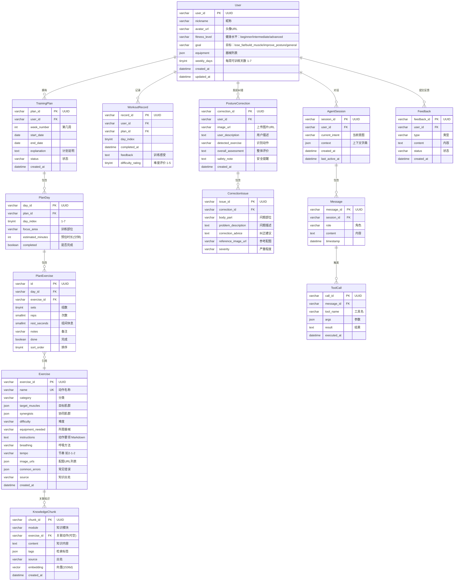

# FitPulse 数据库设计说明书

| 项目 | 内容 |
|---|---|
| 项目名称 | FitPulse 健身动作矫正 & 居家锻炼智能 Agent |
| 团队名称 | FitPulse |
| 文档版本 | v1.0 |
| 编制日期 | 2026-11-05 |
| 文档状态 | 正式 |
| 参考规范 | GB/T 8567-2006《计算机软件文档编制规范》 |

---

## 文档修订记录

| 版本 | 日期 | 修改人 | 修改内容 |
|---|---|---|---|
| v1.0 | 2026-11-05 | 罗炜、徐心铭、马锦城 | 初稿，完成全部章节 |

---

## 1. 引言

### 1.1 编写目的

本文档是 FitPulse 健身动作矫正智能体的数据库设计说明书，旨在：

1. 明确数据库的整体设计思路、概念结构、逻辑结构和物理结构；
2. 定义所有数据表、字段、约束、索引及表间关系，为后端开发提供数据层的实现依据；
3. 说明领域知识、用户交互记录和任务执行结果等数据的存储与管理方式；
4. 为数据库的部署、维护和后续迭代提供参考。

预期读者：后端开发工程师、RAG/知识库工程师、测试工程师、项目指导教师与助教。

### 1.2 项目背景

FitPulse 是一款面向学生健身新手的智能教练软件，基于 Claude 大模型 API，通过提示词设计、知识检索（RAG）、工具调用与流程编排，提供文字+图片指导、训练计划生成、动作纠错三大核心能力。

软件涉及的数据类别包括：

- **业务数据**：用户档案、训练计划、纠错记录、训练打卡等
- **领域知识数据**：标准动作、肌肉发力、错误姿势危害三大知识模块的结构化条目及其向量
- **会话数据**：用户与 Agent 的对话历史、工具调用日志
- **文件数据**：动作配图、用户上传的动作照片、头像等

### 1.3 定义与缩写

| 术语/缩写 | 定义 |
|---|---|
| ER 图 | Entity-Relationship Diagram，实体-关系图 |
| ORM | Object-Relational Mapping，对象关系映射 |
| PK | Primary Key，主键 |
| FK | Foreign Key，外键 |
| UUID | Universally Unique Identifier，通用唯一标识符 |
| JSON | JavaScript Object Notation，用于存储半结构化数据 |
| VECTOR | 向量数据类型，用于存储文本的 Embedding 向量 |
| RAG | Retrieval-Augmented Generation，检索增强生成 |

### 1.4 参考资料

- 《FitPulse 需求分析文档》v0.1
- 《FitPulse 系统设计说明书》v1.0
- GB/T 8567-2006《计算机软件文档编制规范》
- MySQL 8.0 Reference Manual
- Chroma Vector Database Documentation

---

## 2. 数据库总体设计

### 2.1 设计原则

1. **规范性与完整性**：遵循第三范式（3NF）设计关系型数据表，消除数据冗余，保证数据一致性。
2. **扩展性**：对半结构化数据（如器械列表、标签、配图URL）使用 JSON 类型字段，避免为可变属性频繁修改表结构。
3. **可追溯性**：关键业务表包含 `created_at` 时间戳，记录数据创建时间，支持按时间回溯。
4. **安全与隐私**：用户上传的动作照片和个人训练数据属于敏感信息，需在数据库层面配合应用层做好访问控制。
5. **多模态支持**：领域知识需要同时支持结构化查询和语义向量检索，采用 MySQL + 向量数据库的混合存储方案。

### 2.2 数据分类与存储策略

| 数据类别 | 存储系统 | 说明 |
|---|---|---|
| 结构化业务数据 | MySQL 8.0 | 用户、计划、纠错、会话、反馈等关系型数据 |
| 领域知识条目 | MySQL（结构化字段）+ Chroma（向量） | MySQL 存原始条目，Chroma 存向量供语义检索 |
| 对话消息 | MySQL | 消息记录、工具调用日志 |
| 文件（图片等） | MinIO 对象存储 | 动作配图、用户上传照片、头像；MySQL 存 URL 引用 |

### 2.3 数据库部署架构

```
┌───────────────────────────────────────────────────┐
│                   FitPulse 应用                     │
│                                                     │
│  ┌─────────────┐  ┌─────────────┐  ┌────────────┐  │
│  │ 业务数据操作  │  │ 知识检索     │  │ 文件上传     │  │
│  │ (SQLAlchemy) │  │ (Chroma SDK)│  │ (boto3/S3) │  │
│  └──────┬──────┘  └──────┬──────┘  └──────┬─────┘  │
│         │                │                │         │
└─────────┼────────────────┼────────────────┼─────────┘
          │                │                │
          ▼                ▼                ▼
   ┌──────────────┐ ┌──────────────┐ ┌──────────────┐
   │   MySQL 8.0  │ │    Chroma    │ │    MinIO     │
   │   :3306      │ │    :8001     │ │    :9000     │
   │              │ │              │ │              │
   │  · users     │ │  · 标准动作   │ │  · 动作配图   │
   │  · exercises │ │  · 肌肉发力   │ │  · 纠错照片   │
   │  · plans     │ │  · 错误姿势   │ │  · 头像      │
   │  · sessions  │ │              │ │              │
   │  · ...       │ │  向量维度:   │ │              │
   │              │ │  1536       │ │              │
   └──────────────┘ └──────────────┘ └──────────────┘
```

---

## 3. 概念结构设计（ER 图）

### 3.1 实体-关系总览

系统包含以下核心实体：

| 实体 | 说明 | 主要属性 |
|---|---|---|
| User（用户） | 系统使用者 | 昵称、健身水平、目标、器械、每周天数 |
| Exercise（动作） | 标准动作条目 | 名称、分类、目标肌群、要领、配图、出处 |
| KnowledgeChunk（知识片段） | 领域知识条目（向量化） | 模块、内容、标签、出处、Embedding |
| TrainingPlan（训练计划） | 用户的一周训练计划 | 周数、起止日期、状态 |
| PlanDay（训练日） | 计划中的某一天 | 训练部位、预估时长、完成状态 |
| PlanExercise（计划动作） | 训练日中的一个动作 | 组数、次数、休息、完成状态 |
| PostureCorrection（纠错记录） | 一次动作纠错 | 上传图片URL、识别动作、整体评价、安全提示 |
| CorrectionIssue（纠错问题） | 纠错中发现的一个具体问题 | 部位、问题描述、纠正建议、严重程度 |
| AgentSession（会话） | 一次对话会话 | 当前意图、上下文字典 |
| Message（消息） | 会话中的一条消息 | 角色、内容、时间戳 |
| ToolCall（工具调用） | 消息关联的工具调用 | 工具名、参数、结果 |
| WorkoutRecord（训练记录） | 一次训练完成记录 | 反馈、难度评价 |
| Feedback（用户反馈） | 用户对系统的反馈 | 类型、内容、状态 |

### 3.2 ER 图（Mermaid）



---

## 4. 逻辑结构设计（关系数据模型）

### 4.1 表汇总

| 序号 | 表名 | 中文名 | 存储引擎 | 字符集 |
|---|---|---|---|---|
| 1 | users | 用户表 | InnoDB | utf8mb4 |
| 2 | exercises | 动作表 | InnoDB | utf8mb4 |
| 3 | knowledge_chunks | 知识片段表 | InnoDB | utf8mb4 |
| 4 | training_plans | 训练计划表 | InnoDB | utf8mb4 |
| 5 | plan_days | 训练日表 | InnoDB | utf8mb4 |
| 6 | plan_exercises | 计划动作表 | InnoDB | utf8mb4 |
| 7 | posture_corrections | 纠错记录表 | InnoDB | utf8mb4 |
| 8 | correction_issues | 纠错问题表 | InnoDB | utf8mb4 |
| 9 | agent_sessions | 会话表 | InnoDB | utf8mb4 |
| 10 | messages | 消息表 | InnoDB | utf8mb4 |
| 11 | tool_calls | 工具调用表 | InnoDB | utf8mb4 |
| 12 | workout_records | 训练记录表 | InnoDB | utf8mb4 |
| 13 | feedbacks | 反馈表 | InnoDB | utf8mb4 |

### 4.2 表详细设计

#### 4.2.1 users（用户表）

| 字段名 | 数据类型 | 约束 | 默认值 | 说明 |
|---|---|---|---|---|
| user_id | VARCHAR(36) | PK, NOT NULL | — | UUID v4 |
| nickname | VARCHAR(50) | NOT NULL | — | 用户昵称 |
| avatar_url | VARCHAR(500) | NULL | NULL | 头像图片 URL（MinIO） |
| fitness_level | ENUM('beginner','intermediate','advanced') | NOT NULL | 'beginner' | 健身水平 |
| goal | ENUM('lose_fat','build_muscle','improve_posture','general') | NOT NULL | 'general' | 健身目标 |
| equipment | JSON | NULL | NULL | 可用器械列表，如 `["瑜伽垫","弹力带"]` |
| weekly_days | TINYINT UNSIGNED | NOT NULL | 3 | 每周可训练天数，范围 1-7 |
| created_at | DATETIME | NOT NULL | CURRENT_TIMESTAMP | 创建时间 |
| updated_at | DATETIME | NOT NULL | CURRENT_TIMESTAMP ON UPDATE | 更新时间 |

**索引**：

| 索引名 | 字段 | 类型 |
|---|---|---|
| PRIMARY | user_id | 主键 |
| idx_users_created | created_at | 普通索引 |

#### 4.2.2 exercises（动作表）

| 字段名 | 数据类型 | 约束 | 默认值 | 说明 |
|---|---|---|---|---|
| exercise_id | VARCHAR(36) | PK, NOT NULL | — | UUID v4 |
| name | VARCHAR(100) | UK, NOT NULL | — | 动作名称，唯一 |
| category | VARCHAR(50) | NOT NULL | — | 分类：胸/背/腿/肩/核心/全身 |
| target_muscles | JSON | NOT NULL | — | 目标肌群，如 `["胸大肌","肱三头肌"]` |
| synergists | JSON | NULL | NULL | 协同肌群 |
| difficulty | ENUM('beginner','intermediate','advanced') | NOT NULL | 'beginner' | 难度 |
| equipment_needed | VARCHAR(200) | NULL | '无' | 所需器械 |
| instructions | TEXT | NOT NULL | — | 动作要领（Markdown 格式） |
| breathing | VARCHAR(500) | NULL | NULL | 呼吸方法 |
| tempo | VARCHAR(50) | NULL | NULL | 动作节奏，如 "2-1-2" |
| image_urls | JSON | NULL | NULL | 配图 URL 列表（MinIO） |
| common_errors | JSON | NULL | NULL | 常见错误列表 |
| source | VARCHAR(500) | NULL | NULL | 知识出处，如"《运动解剖学》第5章" |
| created_at | DATETIME | NOT NULL | CURRENT_TIMESTAMP | 创建时间 |

**索引**：

| 索引名 | 字段 | 类型 |
|---|---|---|
| PRIMARY | exercise_id | 主键 |
| uk_exercises_name | name | 唯一索引 |
| idx_exercises_category | category | 普通索引 |
| idx_exercises_difficulty | difficulty | 普通索引 |

#### 4.2.3 knowledge_chunks（知识片段表）

| 字段名 | 数据类型 | 约束 | 默认值 | 说明 |
|---|---|---|---|---|
| chunk_id | VARCHAR(36) | PK, NOT NULL | — | UUID v4 |
| module | ENUM('standard_action','muscle_activation','error_harm') | NOT NULL | — | 知识模块 |
| exercise_id | VARCHAR(36) | NULL, FK→exercises | NULL | 关联动作（可为空，通用知识不关联具体动作） |
| content | TEXT | NOT NULL | — | 知识内容 |
| tags | JSON | NULL | NULL | 检索标签，如 `["深蹲","下肢","新手"]` |
| source | VARCHAR(500) | NULL | NULL | 出处 |
| created_at | DATETIME | NOT NULL | CURRENT_TIMESTAMP | 创建时间 |

**说明**：`embedding` 向量字段在 MySQL 中不存储（或因插件支持而使用 `VECTOR(1536)` 类型），实际向量存储于 Chroma 向量数据库中。`chunk_id` 作为两个存储之间的关联键。

**索引**：

| 索引名 | 字段 | 类型 |
|---|---|---|
| PRIMARY | chunk_id | 主键 |
| idx_kc_module | module | 普通索引 |
| idx_kc_exercise | exercise_id | 外键索引 |

**Chroma 向量数据库中的对应 Collection**：

| Collection 名 | 维度 | 距离度量 | 元数据字段 |
|---|---|---|---|
| knowledge_vectors | 1536 | cosine | chunk_id, module, exercise_id, tags, source |

#### 4.2.4 training_plans（训练计划表）

| 字段名 | 数据类型 | 约束 | 默认值 | 说明 |
|---|---|---|---|---|
| plan_id | VARCHAR(36) | PK, NOT NULL | — | UUID v4 |
| user_id | VARCHAR(36) | FK→users, NOT NULL | — | 所属用户 |
| week_number | INT | NOT NULL | — | 第几周（自用户注册起算） |
| start_date | DATE | NOT NULL | — | 开始日期 |
| end_date | DATE | NOT NULL | — | 结束日期 |
| explanation | TEXT | NULL | NULL | 计划说明（Markdown） |
| status | ENUM('active','completed','abandoned') | NOT NULL | 'active' | 状态 |
| created_at | DATETIME | NOT NULL | CURRENT_TIMESTAMP | 创建时间 |

**索引**：

| 索引名 | 字段 | 类型 |
|---|---|---|
| PRIMARY | plan_id | 主键 |
| idx_tp_user | user_id | 外键索引 |
| idx_tp_user_status | (user_id, status) | 复合索引（查询活跃计划） |

#### 4.2.5 plan_days（训练日表）

| 字段名 | 数据类型 | 约束 | 默认值 | 说明 |
|---|---|---|---|---|
| day_id | VARCHAR(36) | PK, NOT NULL | — | UUID v4 |
| plan_id | VARCHAR(36) | FK→training_plans, NOT NULL | — | 所属计划 |
| day_index | TINYINT UNSIGNED | NOT NULL | — | 星期几，1-7 |
| focus_area | VARCHAR(100) | NOT NULL | — | 训练部位，如"胸部+肱三头肌" |
| estimated_minutes | INT UNSIGNED | NULL | NULL | 预估时长（分钟） |
| completed | BOOLEAN | NOT NULL | FALSE | 是否完成 |

**索引**：

| 索引名 | 字段 | 类型 |
|---|---|---|
| PRIMARY | day_id | 主键 |
| idx_pd_plan | plan_id | 外键索引 |
| uk_pd_plan_day | (plan_id, day_index) | 唯一索引（同一计划同一天仅一条） |

#### 4.2.6 plan_exercises（计划动作表）

| 字段名 | 数据类型 | 约束 | 默认值 | 说明 |
|---|---|---|---|---|
| id | VARCHAR(36) | PK, NOT NULL | — | UUID v4 |
| day_id | VARCHAR(36) | FK→plan_days, NOT NULL | — | 所属训练日 |
| exercise_id | VARCHAR(36) | FK→exercises, NOT NULL | — | 引用动作 |
| sets | TINYINT UNSIGNED | NOT NULL | 3 | 组数 |
| reps | SMALLINT UNSIGNED | NOT NULL | 12 | 每组次数 |
| rest_seconds | SMALLINT UNSIGNED | NOT NULL | 60 | 组间休息（秒） |
| notes | VARCHAR(500) | NULL | NULL | 备注（如"注意控制下放速度"） |
| done | BOOLEAN | NOT NULL | FALSE | 是否完成 |
| sort_order | TINYINT UNSIGNED | NOT NULL | 0 | 排序号 |

**索引**：

| 索引名 | 字段 | 类型 |
|---|---|---|
| PRIMARY | id | 主键 |
| idx_pe_day | day_id | 外键索引 |
| idx_pe_exercise | exercise_id | 外键索引 |

#### 4.2.7 posture_corrections（纠错记录表）

| 字段名 | 数据类型 | 约束 | 默认值 | 说明 |
|---|---|---|---|---|
| correction_id | VARCHAR(36) | PK, NOT NULL | — | UUID v4 |
| user_id | VARCHAR(36) | FK→users, NOT NULL | — | 所属用户 |
| image_url | VARCHAR(500) | NOT NULL | — | 上传的动作照片 URL（MinIO） |
| user_description | TEXT | NULL | NULL | 用户补充的文字描述 |
| detected_exercise | VARCHAR(100) | NULL | NULL | Agent 识别出的动作名称 |
| overall_assessment | TEXT | NULL | NULL | 整体评价 |
| safety_note | TEXT | NULL | NULL | 安全提醒（如有伤痛信号） |
| created_at | DATETIME | NOT NULL | CURRENT_TIMESTAMP | 创建时间 |

**索引**：

| 索引名 | 字段 | 类型 |
|---|---|---|
| PRIMARY | correction_id | 主键 |
| idx_pc_user | user_id | 外键索引 |
| idx_pc_user_time | (user_id, created_at DESC) | 复合索引（查历史记录） |

#### 4.2.8 correction_issues（纠错问题表）

| 字段名 | 数据类型 | 约束 | 默认值 | 说明 |
|---|---|---|---|---|
| issue_id | VARCHAR(36) | PK, NOT NULL | — | UUID v4 |
| correction_id | VARCHAR(36) | FK→posture_corrections, NOT NULL | — | 所属纠错记录 |
| body_part | VARCHAR(50) | NOT NULL | — | 问题部位，如"腰部"、"膝盖" |
| problem_description | TEXT | NOT NULL | — | 问题描述 |
| correction_advice | TEXT | NOT NULL | — | 纠正建议 |
| reference_image_url | VARCHAR(500) | NULL | NULL | 参考配图 URL |
| severity | ENUM('mild','moderate','severe') | NOT NULL | 'moderate' | 严重程度 |

**索引**：

| 索引名 | 字段 | 类型 |
|---|---|---|
| PRIMARY | issue_id | 主键 |
| idx_ci_correction | correction_id | 外键索引 |

#### 4.2.9 agent_sessions（会话表）

| 字段名 | 数据类型 | 约束 | 默认值 | 说明 |
|---|---|---|---|---|
| session_id | VARCHAR(36) | PK, NOT NULL | — | UUID v4 |
| user_id | VARCHAR(36) | FK→users, NOT NULL | — | 所属用户 |
| current_intent | VARCHAR(50) | NULL | NULL | 当前识别到的意图 |
| context | JSON | NULL | NULL | 会话上下文（如已采集的档案信息、中间状态） |
| created_at | DATETIME | NOT NULL | CURRENT_TIMESTAMP | 创建时间 |
| last_active_at | DATETIME | NOT NULL | CURRENT_TIMESTAMP | 最后活跃时间 |

**索引**：

| 索引名 | 字段 | 类型 |
|---|---|---|
| PRIMARY | session_id | 主键 |
| idx_as_user | user_id | 外键索引 |
| idx_as_active | last_active_at DESC | 普通索引（清理过期会话） |

#### 4.2.10 messages（消息表）

| 字段名 | 数据类型 | 约束 | 默认值 | 说明 |
|---|---|---|---|---|
| message_id | VARCHAR(36) | PK, NOT NULL | — | UUID v4 |
| session_id | VARCHAR(36) | FK→agent_sessions, NOT NULL | — | 所属会话 |
| role | ENUM('user','assistant','system','tool') | NOT NULL | — | 消息角色 |
| content | TEXT | NOT NULL | — | 消息内容 |
| timestamp | DATETIME | NOT NULL | CURRENT_TIMESTAMP | 时间戳 |

**索引**：

| 索引名 | 字段 | 类型 |
|---|---|---|
| PRIMARY | message_id | 主键 |
| idx_msg_session | (session_id, timestamp) | 复合索引（按时间查历史） |

#### 4.2.11 tool_calls（工具调用表）

| 字段名 | 数据类型 | 约束 | 默认值 | 说明 |
|---|---|---|---|---|
| call_id | VARCHAR(36) | PK, NOT NULL | — | UUID v4 |
| message_id | VARCHAR(36) | FK→messages, NOT NULL | — | 关联的 assistant 消息 |
| tool_name | VARCHAR(100) | NOT NULL | — | 工具名称 |
| args | JSON | NULL | NULL | 调用参数 |
| result | TEXT | NULL | NULL | 返回结果 |
| executed_at | DATETIME | NOT NULL | CURRENT_TIMESTAMP | 执行时间 |

**索引**：

| 索引名 | 字段 | 类型 |
|---|---|---|
| PRIMARY | call_id | 主键 |
| idx_tc_message | message_id | 外键索引 |

#### 4.2.12 workout_records（训练记录表）

| 字段名 | 数据类型 | 约束 | 默认值 | 说明 |
|---|---|---|---|---|
| record_id | VARCHAR(36) | PK, NOT NULL | — | UUID v4 |
| user_id | VARCHAR(36) | FK→users, NOT NULL | — | 所属用户 |
| plan_id | VARCHAR(36) | FK→training_plans, NULL | NULL | 关联计划（可为空，自由训练） |
| day_index | TINYINT UNSIGNED | NOT NULL | — | 训练日（1-7） |
| completed_at | DATETIME | NOT NULL | CURRENT_TIMESTAMP | 完成时间 |
| feedback | TEXT | NULL | NULL | 训练感受 |
| difficulty_rating | TINYINT UNSIGNED | NULL | NULL | 难度评价 1-5（1太轻松，5太困难） |

**索引**：

| 索引名 | 字段 | 类型 |
|---|---|---|
| PRIMARY | record_id | 主键 |
| idx_wr_user | (user_id, completed_at DESC) | 复合索引（查用户训练历史） |
| idx_wr_plan | plan_id | 外键索引 |

#### 4.2.13 feedbacks（反馈表）

| 字段名 | 数据类型 | 约束 | 默认值 | 说明 |
|---|---|---|---|---|
| feedback_id | VARCHAR(36) | PK, NOT NULL | — | UUID v4 |
| user_id | VARCHAR(36) | FK→users, NOT NULL | — | 所属用户 |
| type | ENUM('bug','feature','praise','other') | NOT NULL | — | 反馈类型 |
| content | TEXT | NOT NULL | — | 反馈内容 |
| status | ENUM('pending','processing','resolved') | NOT NULL | 'pending' | 处理状态 |
| created_at | DATETIME | NOT NULL | CURRENT_TIMESTAMP | 创建时间 |

**索引**：

| 索引名 | 字段 | 类型 |
|---|---|---|
| PRIMARY | feedback_id | 主键 |
| idx_fb_status | status | 普通索引（按状态筛选） |

---

## 5. 物理结构设计

### 5.1 数据库创建脚本（DDL 概要）

```sql
-- 创建数据库
CREATE DATABASE IF NOT EXISTS fitpulse
  DEFAULT CHARACTER SET utf8mb4
  DEFAULT COLLATE utf8mb4_unicode_ci;

USE fitpulse;

-- 用户表
CREATE TABLE users (
  user_id VARCHAR(36) NOT NULL,
  nickname VARCHAR(50) NOT NULL,
  avatar_url VARCHAR(500) NULL,
  fitness_level ENUM('beginner','intermediate','advanced') NOT NULL DEFAULT 'beginner',
  goal ENUM('lose_fat','build_muscle','improve_posture','general') NOT NULL DEFAULT 'general',
  equipment JSON NULL,
  weekly_days TINYINT UNSIGNED NOT NULL DEFAULT 3,
  created_at DATETIME NOT NULL DEFAULT CURRENT_TIMESTAMP,
  updated_at DATETIME NOT NULL DEFAULT CURRENT_TIMESTAMP ON UPDATE CURRENT_TIMESTAMP,
  PRIMARY KEY (user_id),
  INDEX idx_users_created (created_at)
) ENGINE=InnoDB DEFAULT CHARSET=utf8mb4 COLLATE=utf8mb4_unicode_ci;

-- 动作表
CREATE TABLE exercises (
  exercise_id VARCHAR(36) NOT NULL,
  name VARCHAR(100) NOT NULL,
  category VARCHAR(50) NOT NULL,
  target_muscles JSON NOT NULL,
  synergists JSON NULL,
  difficulty ENUM('beginner','intermediate','advanced') NOT NULL DEFAULT 'beginner',
  equipment_needed VARCHAR(200) NULL DEFAULT '无',
  instructions TEXT NOT NULL,
  breathing VARCHAR(500) NULL,
  tempo VARCHAR(50) NULL,
  image_urls JSON NULL,
  common_errors JSON NULL,
  source VARCHAR(500) NULL,
  created_at DATETIME NOT NULL DEFAULT CURRENT_TIMESTAMP,
  PRIMARY KEY (exercise_id),
  UNIQUE INDEX uk_exercises_name (name),
  INDEX idx_exercises_category (category),
  INDEX idx_exercises_difficulty (difficulty)
) ENGINE=InnoDB DEFAULT CHARSET=utf8mb4 COLLATE=utf8mb4_unicode_ci;

-- 知识片段表（向量存 Chroma，此处存结构化元数据）
CREATE TABLE knowledge_chunks (
  chunk_id VARCHAR(36) NOT NULL,
  module ENUM('standard_action','muscle_activation','error_harm') NOT NULL,
  exercise_id VARCHAR(36) NULL,
  content TEXT NOT NULL,
  tags JSON NULL,
  source VARCHAR(500) NULL,
  created_at DATETIME NOT NULL DEFAULT CURRENT_TIMESTAMP,
  PRIMARY KEY (chunk_id),
  INDEX idx_kc_module (module),
  INDEX idx_kc_exercise (exercise_id),
  CONSTRAINT fk_kc_exercise FOREIGN KEY (exercise_id) REFERENCES exercises(exercise_id)
    ON DELETE SET NULL ON UPDATE CASCADE
) ENGINE=InnoDB DEFAULT CHARSET=utf8mb4 COLLATE=utf8mb4_unicode_ci;

-- 训练计划表
CREATE TABLE training_plans (
  plan_id VARCHAR(36) NOT NULL,
  user_id VARCHAR(36) NOT NULL,
  week_number INT NOT NULL,
  start_date DATE NOT NULL,
  end_date DATE NOT NULL,
  explanation TEXT NULL,
  status ENUM('active','completed','abandoned') NOT NULL DEFAULT 'active',
  created_at DATETIME NOT NULL DEFAULT CURRENT_TIMESTAMP,
  PRIMARY KEY (plan_id),
  INDEX idx_tp_user (user_id),
  INDEX idx_tp_user_status (user_id, status),
  CONSTRAINT fk_tp_user FOREIGN KEY (user_id) REFERENCES users(user_id)
    ON DELETE CASCADE ON UPDATE CASCADE
) ENGINE=InnoDB DEFAULT CHARSET=utf8mb4 COLLATE=utf8mb4_unicode_ci;

-- 训练日表
CREATE TABLE plan_days (
  day_id VARCHAR(36) NOT NULL,
  plan_id VARCHAR(36) NOT NULL,
  day_index TINYINT UNSIGNED NOT NULL,
  focus_area VARCHAR(100) NOT NULL,
  estimated_minutes INT UNSIGNED NULL,
  completed BOOLEAN NOT NULL DEFAULT FALSE,
  PRIMARY KEY (day_id),
  UNIQUE INDEX uk_pd_plan_day (plan_id, day_index),
  CONSTRAINT fk_pd_plan FOREIGN KEY (plan_id) REFERENCES training_plans(plan_id)
    ON DELETE CASCADE ON UPDATE CASCADE
) ENGINE=InnoDB DEFAULT CHARSET=utf8mb4 COLLATE=utf8mb4_unicode_ci;

-- 计划动作表
CREATE TABLE plan_exercises (
  id VARCHAR(36) NOT NULL,
  day_id VARCHAR(36) NOT NULL,
  exercise_id VARCHAR(36) NOT NULL,
  sets TINYINT UNSIGNED NOT NULL DEFAULT 3,
  reps SMALLINT UNSIGNED NOT NULL DEFAULT 12,
  rest_seconds SMALLINT UNSIGNED NOT NULL DEFAULT 60,
  notes VARCHAR(500) NULL,
  done BOOLEAN NOT NULL DEFAULT FALSE,
  sort_order TINYINT UNSIGNED NOT NULL DEFAULT 0,
  PRIMARY KEY (id),
  INDEX idx_pe_day (day_id),
  INDEX idx_pe_exercise (exercise_id),
  CONSTRAINT fk_pe_day FOREIGN KEY (day_id) REFERENCES plan_days(day_id)
    ON DELETE CASCADE ON UPDATE CASCADE,
  CONSTRAINT fk_pe_exercise FOREIGN KEY (exercise_id) REFERENCES exercises(exercise_id)
    ON DELETE RESTRICT ON UPDATE CASCADE
) ENGINE=InnoDB DEFAULT CHARSET=utf8mb4 COLLATE=utf8mb4_unicode_ci;

-- 纠错记录表
CREATE TABLE posture_corrections (
  correction_id VARCHAR(36) NOT NULL,
  user_id VARCHAR(36) NOT NULL,
  image_url VARCHAR(500) NOT NULL,
  user_description TEXT NULL,
  detected_exercise VARCHAR(100) NULL,
  overall_assessment TEXT NULL,
  safety_note TEXT NULL,
  created_at DATETIME NOT NULL DEFAULT CURRENT_TIMESTAMP,
  PRIMARY KEY (correction_id),
  INDEX idx_pc_user (user_id),
  INDEX idx_pc_user_time (user_id, created_at DESC),
  CONSTRAINT fk_pc_user FOREIGN KEY (user_id) REFERENCES users(user_id)
    ON DELETE CASCADE ON UPDATE CASCADE
) ENGINE=InnoDB DEFAULT CHARSET=utf8mb4 COLLATE=utf8mb4_unicode_ci;

-- 纠错问题表
CREATE TABLE correction_issues (
  issue_id VARCHAR(36) NOT NULL,
  correction_id VARCHAR(36) NOT NULL,
  body_part VARCHAR(50) NOT NULL,
  problem_description TEXT NOT NULL,
  correction_advice TEXT NOT NULL,
  reference_image_url VARCHAR(500) NULL,
  severity ENUM('mild','moderate','severe') NOT NULL DEFAULT 'moderate',
  PRIMARY KEY (issue_id),
  INDEX idx_ci_correction (correction_id),
  CONSTRAINT fk_ci_correction FOREIGN KEY (correction_id) REFERENCES posture_corrections(correction_id)
    ON DELETE CASCADE ON UPDATE CASCADE
) ENGINE=InnoDB DEFAULT CHARSET=utf8mb4 COLLATE=utf8mb4_unicode_ci;

-- 会话表
CREATE TABLE agent_sessions (
  session_id VARCHAR(36) NOT NULL,
  user_id VARCHAR(36) NOT NULL,
  current_intent VARCHAR(50) NULL,
  context JSON NULL,
  created_at DATETIME NOT NULL DEFAULT CURRENT_TIMESTAMP,
  last_active_at DATETIME NOT NULL DEFAULT CURRENT_TIMESTAMP,
  PRIMARY KEY (session_id),
  INDEX idx_as_user (user_id),
  INDEX idx_as_active (last_active_at DESC),
  CONSTRAINT fk_as_user FOREIGN KEY (user_id) REFERENCES users(user_id)
    ON DELETE CASCADE ON UPDATE CASCADE
) ENGINE=InnoDB DEFAULT CHARSET=utf8mb4 COLLATE=utf8mb4_unicode_ci;

-- 消息表
CREATE TABLE messages (
  message_id VARCHAR(36) NOT NULL,
  session_id VARCHAR(36) NOT NULL,
  role ENUM('user','assistant','system','tool') NOT NULL,
  content TEXT NOT NULL,
  timestamp DATETIME NOT NULL DEFAULT CURRENT_TIMESTAMP,
  PRIMARY KEY (message_id),
  INDEX idx_msg_session (session_id, timestamp),
  CONSTRAINT fk_msg_session FOREIGN KEY (session_id) REFERENCES agent_sessions(session_id)
    ON DELETE CASCADE ON UPDATE CASCADE
) ENGINE=InnoDB DEFAULT CHARSET=utf8mb4 COLLATE=utf8mb4_unicode_ci;

-- 工具调用表
CREATE TABLE tool_calls (
  call_id VARCHAR(36) NOT NULL,
  message_id VARCHAR(36) NOT NULL,
  tool_name VARCHAR(100) NOT NULL,
  args JSON NULL,
  result TEXT NULL,
  executed_at DATETIME NOT NULL DEFAULT CURRENT_TIMESTAMP,
  PRIMARY KEY (call_id),
  INDEX idx_tc_message (message_id),
  CONSTRAINT fk_tc_message FOREIGN KEY (message_id) REFERENCES messages(message_id)
    ON DELETE CASCADE ON UPDATE CASCADE
) ENGINE=InnoDB DEFAULT CHARSET=utf8mb4 COLLATE=utf8mb4_unicode_ci;

-- 训练记录表
CREATE TABLE workout_records (
  record_id VARCHAR(36) NOT NULL,
  user_id VARCHAR(36) NOT NULL,
  plan_id VARCHAR(36) NULL,
  day_index TINYINT UNSIGNED NOT NULL,
  completed_at DATETIME NOT NULL DEFAULT CURRENT_TIMESTAMP,
  feedback TEXT NULL,
  difficulty_rating TINYINT UNSIGNED NULL,
  PRIMARY KEY (record_id),
  INDEX idx_wr_user (user_id, completed_at DESC),
  INDEX idx_wr_plan (plan_id),
  CONSTRAINT fk_wr_user FOREIGN KEY (user_id) REFERENCES users(user_id)
    ON DELETE CASCADE ON UPDATE CASCADE,
  CONSTRAINT fk_wr_plan FOREIGN KEY (plan_id) REFERENCES training_plans(plan_id)
    ON DELETE SET NULL ON UPDATE CASCADE
) ENGINE=InnoDB DEFAULT CHARSET=utf8mb4 COLLATE=utf8mb4_unicode_ci;

-- 反馈表
CREATE TABLE feedbacks (
  feedback_id VARCHAR(36) NOT NULL,
  user_id VARCHAR(36) NOT NULL,
  type ENUM('bug','feature','praise','other') NOT NULL,
  content TEXT NOT NULL,
  status ENUM('pending','processing','resolved') NOT NULL DEFAULT 'pending',
  created_at DATETIME NOT NULL DEFAULT CURRENT_TIMESTAMP,
  PRIMARY KEY (feedback_id),
  INDEX idx_fb_status (status),
  CONSTRAINT fk_fb_user FOREIGN KEY (user_id) REFERENCES users(user_id)
    ON DELETE CASCADE ON UPDATE CASCADE
) ENGINE=InnoDB DEFAULT CHARSET=utf8mb4 COLLATE=utf8mb4_unicode_ci;
```

### 5.2 存储空间估算

| 表名 | 预估单行大小 | 预估行数（首年） | 预估总大小 |
|---|---|---|---|
| users | ~500 B | 1,000 | ~0.5 MB |
| exercises | ~3 KB | 50 | ~0.15 MB |
| knowledge_chunks | ~5 KB | 100 | ~0.5 MB |
| training_plans | ~300 B | 2,000 | ~0.6 MB |
| plan_days | ~200 B | 10,000 | ~2 MB |
| plan_exercises | ~200 B | 50,000 | ~10 MB |
| posture_corrections | ~1 KB | 5,000 | ~5 MB |
| correction_issues | ~1 KB | 15,000 | ~15 MB |
| agent_sessions | ~500 B | 5,000 | ~2.5 MB |
| messages | ~1 KB | 100,000 | ~100 MB |
| tool_calls | ~500 B | 20,000 | ~10 MB |
| workout_records | ~300 B | 10,000 | ~3 MB |
| feedbacks | ~500 B | 500 | ~0.25 MB |
| **合计** | | | **~150 MB** |

> 说明：消息表（messages）是数据量最大的表，建议按季度归档历史消息，或对超过 6 个月的会话进行软删除。

### 5.3 备份策略

| 策略 | 说明 |
|---|---|
| 全量备份 | 每日凌晨 3:00 执行 `mysqldump`，保留最近 7 天 |
| 增量备份 | 每小时执行 binlog 备份 |
| 异地备份 | 每周将全量备份同步至 MinIO 异地 bucket |
| 恢复演练 | 每月执行一次备份恢复演练 |

---

## 6. 对象关系映射（ORM）

### 6.1 实体类与库表的映射关系

以下以 Python SQLAlchemy 2.0 为例说明核心实体与数据库表的映射：

| 实体类 | 库表 | JSON 字段映射 | 枚举字段映射 |
|---|---|---|---|
| User | users | `equipment: list[str]` | `fitness_level: FitnessLevel`, `goal: FitnessGoal` |
| Exercise | exercises | `target_muscles: list[str]`, `image_urls: list[str]`, `common_errors: list[str]` | `difficulty: Difficulty` |
| KnowledgeChunk | knowledge_chunks | `tags: list[str]` | `module: KnowledgeModule` |
| TrainingPlan | training_plans | — | `status: PlanStatus` |
| PlanDay | plan_days | — | — |
| PlanExercise | plan_exercises | — | — |
| PostureCorrection | posture_corrections | — | — |
| CorrectionIssue | correction_issues | — | `severity: Severity` |
| AgentSession | agent_sessions | `context: dict` | — |
| Message | messages | — | `role: MessageRole` |
| ToolCall | tool_calls | `args: dict` | — |
| WorkoutRecord | workout_records | — | — |
| Feedback | feedbacks | — | `type: FeedbackType`, `status: FeedbackStatus` |

### 6.2 核心 ORM 模型示例（Python SQLAlchemy）

```python
from sqlalchemy import (
    Column, String, Integer, Text, Boolean, JSON, Enum,
    DateTime, ForeignKey, SmallInteger, Date, UniqueConstraint
)
from sqlalchemy.orm import DeclarativeBase, relationship
from sqlalchemy.sql import func
import uuid

class Base(DeclarativeBase):
    pass

def gen_uuid():
    return str(uuid.uuid4())


class User(Base):
    __tablename__ = 'users'

    user_id = Column(String(36), primary_key=True, default=gen_uuid)
    nickname = Column(String(50), nullable=False)
    avatar_url = Column(String(500), nullable=True)
    fitness_level = Column(
        Enum('beginner', 'intermediate', 'advanced', name='fitness_level_enum'),
        nullable=False, default='beginner'
    )
    goal = Column(
        Enum('lose_fat', 'build_muscle', 'improve_posture', 'general', name='goal_enum'),
        nullable=False, default='general'
    )
    equipment = Column(JSON, nullable=True)
    weekly_days = Column(Integer, nullable=False, default=3)
    created_at = Column(DateTime, nullable=False, server_default=func.now())
    updated_at = Column(DateTime, nullable=False, server_default=func.now(), onupdate=func.now())

    # 关系
    training_plans = relationship('TrainingPlan', back_populates='user')
    posture_corrections = relationship('PostureCorrection', back_populates='user')
    agent_sessions = relationship('AgentSession', back_populates='user')
    workout_records = relationship('WorkoutRecord', back_populates='user')
    feedbacks = relationship('Feedback', back_populates='user')


class Exercise(Base):
    __tablename__ = 'exercises'

    exercise_id = Column(String(36), primary_key=True, default=gen_uuid)
    name = Column(String(100), unique=True, nullable=False)
    category = Column(String(50), nullable=False)
    target_muscles = Column(JSON, nullable=False)
    synergists = Column(JSON, nullable=True)
    difficulty = Column(
        Enum('beginner', 'intermediate', 'advanced', name='difficulty_enum'),
        nullable=False, default='beginner'
    )
    equipment_needed = Column(String(200), nullable=True, default='无')
    instructions = Column(Text, nullable=False)
    breathing = Column(String(500), nullable=True)
    tempo = Column(String(50), nullable=True)
    image_urls = Column(JSON, nullable=True)
    common_errors = Column(JSON, nullable=True)
    source = Column(String(500), nullable=True)
    created_at = Column(DateTime, nullable=False, server_default=func.now())

    # 关系
    knowledge_chunks = relationship('KnowledgeChunk', back_populates='exercise')
    plan_exercises = relationship('PlanExercise', back_populates='exercise')


class KnowledgeChunk(Base):
    __tablename__ = 'knowledge_chunks'

    chunk_id = Column(String(36), primary_key=True, default=gen_uuid)
    module = Column(
        Enum('standard_action', 'muscle_activation', 'error_harm', name='knowledge_module_enum'),
        nullable=False
    )
    exercise_id = Column(String(36), ForeignKey('exercises.exercise_id', ondelete='SET NULL'), nullable=True)
    content = Column(Text, nullable=False)
    tags = Column(JSON, nullable=True)
    source = Column(String(500), nullable=True)
    created_at = Column(DateTime, nullable=False, server_default=func.now())

    # 关系
    exercise = relationship('Exercise', back_populates='knowledge_chunks')


class TrainingPlan(Base):
    __tablename__ = 'training_plans'

    plan_id = Column(String(36), primary_key=True, default=gen_uuid)
    user_id = Column(String(36), ForeignKey('users.user_id', ondelete='CASCADE'), nullable=False)
    week_number = Column(Integer, nullable=False)
    start_date = Column(Date, nullable=False)
    end_date = Column(Date, nullable=False)
    explanation = Column(Text, nullable=True)
    status = Column(
        Enum('active', 'completed', 'abandoned', name='plan_status_enum'),
        nullable=False, default='active'
    )
    created_at = Column(DateTime, nullable=False, server_default=func.now())

    # 关系
    user = relationship('User', back_populates='training_plans')
    plan_days = relationship('PlanDay', back_populates='training_plan', cascade='all, delete-orphan')
    workout_records = relationship('WorkoutRecord', back_populates='training_plan')


class PlanDay(Base):
    __tablename__ = 'plan_days'

    day_id = Column(String(36), primary_key=True, default=gen_uuid)
    plan_id = Column(String(36), ForeignKey('training_plans.plan_id', ondelete='CASCADE'), nullable=False)
    day_index = Column(SmallInteger, nullable=False)
    focus_area = Column(String(100), nullable=False)
    estimated_minutes = Column(Integer, nullable=True)
    completed = Column(Boolean, nullable=False, default=False)

    __table_args__ = (
        UniqueConstraint('plan_id', 'day_index', name='uk_pd_plan_day'),
    )

    # 关系
    training_plan = relationship('TrainingPlan', back_populates='plan_days')
    plan_exercises = relationship('PlanExercise', back_populates='plan_day', cascade='all, delete-orphan')


class PlanExercise(Base):
    __tablename__ = 'plan_exercises'

    id = Column(String(36), primary_key=True, default=gen_uuid)
    day_id = Column(String(36), ForeignKey('plan_days.day_id', ondelete='CASCADE'), nullable=False)
    exercise_id = Column(String(36), ForeignKey('exercises.exercise_id', ondelete='RESTRICT'), nullable=False)
    sets = Column(SmallInteger, nullable=False, default=3)
    reps = Column(SmallInteger, nullable=False, default=12)
    rest_seconds = Column(SmallInteger, nullable=False, default=60)
    notes = Column(String(500), nullable=True)
    done = Column(Boolean, nullable=False, default=False)
    sort_order = Column(SmallInteger, nullable=False, default=0)

    # 关系
    plan_day = relationship('PlanDay', back_populates='plan_exercises')
    exercise = relationship('Exercise', back_populates='plan_exercises')


class PostureCorrection(Base):
    __tablename__ = 'posture_corrections'

    correction_id = Column(String(36), primary_key=True, default=gen_uuid)
    user_id = Column(String(36), ForeignKey('users.user_id', ondelete='CASCADE'), nullable=False)
    image_url = Column(String(500), nullable=False)
    user_description = Column(Text, nullable=True)
    detected_exercise = Column(String(100), nullable=True)
    overall_assessment = Column(Text, nullable=True)
    safety_note = Column(Text, nullable=True)
    created_at = Column(DateTime, nullable=False, server_default=func.now())

    # 关系
    user = relationship('User', back_populates='posture_corrections')
    issues = relationship('CorrectionIssue', back_populates='correction', cascade='all, delete-orphan')


class CorrectionIssue(Base):
    __tablename__ = 'correction_issues'

    issue_id = Column(String(36), primary_key=True, default=gen_uuid)
    correction_id = Column(String(36), ForeignKey('posture_corrections.correction_id', ondelete='CASCADE'), nullable=False)
    body_part = Column(String(50), nullable=False)
    problem_description = Column(Text, nullable=False)
    correction_advice = Column(Text, nullable=False)
    reference_image_url = Column(String(500), nullable=True)
    severity = Column(
        Enum('mild', 'moderate', 'severe', name='severity_enum'),
        nullable=False, default='moderate'
    )

    # 关系
    correction = relationship('PostureCorrection', back_populates='issues')


class AgentSession(Base):
    __tablename__ = 'agent_sessions'

    session_id = Column(String(36), primary_key=True, default=gen_uuid)
    user_id = Column(String(36), ForeignKey('users.user_id', ondelete='CASCADE'), nullable=False)
    current_intent = Column(String(50), nullable=True)
    context = Column(JSON, nullable=True)
    created_at = Column(DateTime, nullable=False, server_default=func.now())
    last_active_at = Column(DateTime, nullable=False, server_default=func.now())

    # 关系
    user = relationship('User', back_populates='agent_sessions')
    messages = relationship('Message', back_populates='session', cascade='all, delete-orphan')


class Message(Base):
    __tablename__ = 'messages'

    message_id = Column(String(36), primary_key=True, default=gen_uuid)
    session_id = Column(String(36), ForeignKey('agent_sessions.session_id', ondelete='CASCADE'), nullable=False)
    role = Column(
        Enum('user', 'assistant', 'system', 'tool', name='message_role_enum'),
        nullable=False
    )
    content = Column(Text, nullable=False)
    timestamp = Column(DateTime, nullable=False, server_default=func.now())

    # 关系
    session = relationship('AgentSession', back_populates='messages')
    tool_calls = relationship('ToolCall', back_populates='message', cascade='all, delete-orphan')


class ToolCall(Base):
    __tablename__ = 'tool_calls'

    call_id = Column(String(36), primary_key=True, default=gen_uuid)
    message_id = Column(String(36), ForeignKey('messages.message_id', ondelete='CASCADE'), nullable=False)
    tool_name = Column(String(100), nullable=False)
    args = Column(JSON, nullable=True)
    result = Column(Text, nullable=True)
    executed_at = Column(DateTime, nullable=False, server_default=func.now())

    # 关系
    message = relationship('Message', back_populates='tool_calls')


class WorkoutRecord(Base):
    __tablename__ = 'workout_records'

    record_id = Column(String(36), primary_key=True, default=gen_uuid)
    user_id = Column(String(36), ForeignKey('users.user_id', ondelete='CASCADE'), nullable=False)
    plan_id = Column(String(36), ForeignKey('training_plans.plan_id', ondelete='SET NULL'), nullable=True)
    day_index = Column(SmallInteger, nullable=False)
    completed_at = Column(DateTime, nullable=False, server_default=func.now())
    feedback = Column(Text, nullable=True)
    difficulty_rating = Column(SmallInteger, nullable=True)

    # 关系
    user = relationship('User', back_populates='workout_records')
    training_plan = relationship('TrainingPlan', back_populates='workout_records')


class Feedback(Base):
    __tablename__ = 'feedbacks'

    feedback_id = Column(String(36), primary_key=True, default=gen_uuid)
    user_id = Column(String(36), ForeignKey('users.user_id', ondelete='CASCADE'), nullable=False)
    type = Column(
        Enum('bug', 'feature', 'praise', 'other', name='feedback_type_enum'),
        nullable=False
    )
    content = Column(Text, nullable=False)
    status = Column(
        Enum('pending', 'processing', 'resolved', name='feedback_status_enum'),
        nullable=False, default='pending'
    )
    created_at = Column(DateTime, nullable=False, server_default=func.now())

    # 关系
    user = relationship('User', back_populates='feedbacks')
```

---

## 7. 领域知识、交互记录与任务结果的数据管理

### 7.1 领域知识的数据管理

#### 7.1.1 知识生命周期

```
[领域专家整理] → [结构化录入] → [审核确认] → [向量化入Chroma] → [Agent检索使用]
                                                                    │
                                                    ┌───────────────┘
                                                    ▼
                                              [用户反馈] → [知识修订] → [重新向量化]
```

#### 7.1.2 知识存储方式

| 存储层 | 系统 | 内容 | 用途 |
|---|---|---|---|
| 结构化层 | MySQL `exercises` + `knowledge_chunks` | 动作要领、知识条目、来源 | CRUD 管理、出处展示、数据备份 |
| 向量层 | Chroma Collections | 1536 维 Embedding 向量 | 语义检索、相似度匹配 |

#### 7.1.3 知识检索与注入流程

```
用户提问 "深蹲膝盖不舒服怎么办"
        │
        ▼
   查询向量化 (Claude Embedding API)
        │
        ▼
   Chroma 语义检索 (Top-5, cosine similarity)
        │
        ▼
   重排序 (按相关度 + 知识模块权重)
        │
        ▼
   取 Top-3 知识片段 → 注入 LLM 上下文
        │
        ▼
   LLM 生成回答（标注出处：chunk.source）
```

### 7.2 用户交互记录的数据管理

#### 7.2.1 会话数据流

```
用户发送消息
    │
    ▼
创建/更新 AgentSession（记录 current_intent + context）
    │
    ▼
新增 Message（role=user）
    │
    ▼
Agent 处理（可能多次 tool_calls）
    │  ├── 新增 Message（role=assistant，tool_calls 请求）
    │  │   └── 新增 ToolCall（记录 tool_name + args）
    │  ├── 工具执行
    │  │   └── 新增 Message（role=tool，工具返回结果）
    │  └── 新增 Message（role=assistant，最终回答）
    │       └── 更新 ToolCall.result
    │
    ▼
返回给前端（SSE 流）
```

#### 7.2.2 上下文管理

`agent_sessions.context`（JSON 字段）存储会话中间状态：

```json
{
  "onboarding_complete": true,
  "collected_profile": {
    "fitness_level": "beginner",
    "goal": "build_muscle",
    "equipment": ["瑜伽垫", "弹力带"],
    "weekly_days": 4
  },
  "last_tool": "generate_plan",
  "last_exercise_queried": "深蹲",
  "pending_plan_id": "uuid-xxx"
}
```

### 7.3 任务执行结果的数据管理

| 任务类型 | 存储表 | 关键字段 | 数据用途 |
|---|---|---|---|
| 动作查询 | messages + tool_calls | tool_name='query_exercise', result | 缓存常用动作回答，分析高频查询 |
| 训练计划生成 | training_plans + plan_days + plan_exercises | 完整计划结构 | 用户查看、打卡、后续计划参考 |
| 动作纠错 | posture_corrections + correction_issues | 图片URL + 纠错结果 | 用户回溯、发现常见错误模式 |
| 训练打卡 | workout_records | feedback + difficulty_rating | 分析计划合理性、调整难度 |

---

## 附录 A：数据字典（快速查阅）

| 表名 | 主键 | 核心外键 | 记录数预估 | 增长速度 |
|---|---|---|---|---|
| users | user_id | — | ~1,000/年 | 缓慢 |
| exercises | exercise_id | — | ~50 | 极慢（手动维护） |
| knowledge_chunks | chunk_id | exercise_id (可空) | ~100 | 慢（手动维护） |
| training_plans | plan_id | user_id | ~2,000/年 | 中等（每用户周级） |
| plan_days | day_id | plan_id | ~10,000/年 | 中等 |
| plan_exercises | id | day_id, exercise_id | ~50,000/年 | 较快 |
| posture_corrections | correction_id | user_id | ~5,000/年 | 中等 |
| correction_issues | issue_id | correction_id | ~15,000/年 | 中等 |
| agent_sessions | session_id | user_id | ~5,000/年 | 中等 |
| messages | message_id | session_id | ~100,000/年 | 快 |
| tool_calls | call_id | message_id | ~20,000/年 | 中等 |
| workout_records | record_id | user_id, plan_id | ~10,000/年 | 中等 |
| feedbacks | feedback_id | user_id | ~500/年 | 慢 |

## 附录 B：Chroma 向量库初始化脚本（概要）

```python
# scripts/init_knowledge_base.py
import chromadb
from chromadb.utils import embedding_functions
import mysql.connector

# 1. 连接 Chroma
client = chromadb.PersistentClient(path="./chroma_data")
embedding_fn = embedding_functions.ClaudeEmbeddingFunction(
    api_key="your-api-key",
    model_name="claude-embedding-3-20250604"
)

# 2. 创建/获取 Collection
collection = client.get_or_create_collection(
    name="knowledge_vectors",
    embedding_function=embedding_fn,
    metadata={"description": "FitPulse 领域知识向量库"}
)

# 3. 从 MySQL 读取知识条目
db = mysql.connector.connect(
    host="localhost", user="fitpulse", password="***", database="fitpulse"
)
cursor = db.cursor(dictionary=True)
cursor.execute("SELECT chunk_id, module, content, tags, source FROM knowledge_chunks")
chunks = cursor.fetchall()

# 4. 批量向量化并写入 Chroma
ids = [c['chunk_id'] for c in chunks]
documents = [c['content'] for c in chunks]
metadatas = [
    {'module': c['module'], 'tags': str(c.get('tags', '')), 'source': c.get('source', '')}
    for c in chunks
]
collection.add(ids=ids, documents=documents, metadatas=metadatas)

print(f"✅ 知识库初始化完成：{len(chunks)} 条知识已向量化")
```