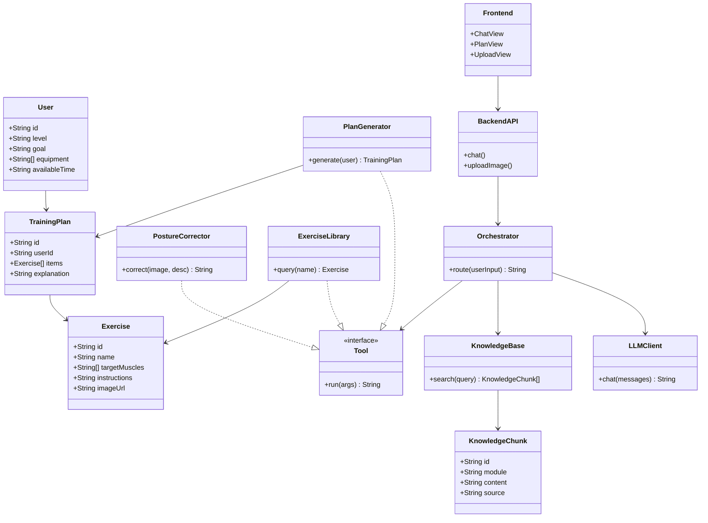

# FitPulse 健身动作矫正智能体 —— 需求分析文档

| 项目 | 内容 |
|---|---|
| 项目名称 | FitPulse 健身动作矫正 & 居家锻炼智能 Agent |
| 团队名称 | FitPulse |
| 文档版本 | v0.1（初稿） |
| 编制日期 | 2026-10-23 |
| 文档状态 | 草稿（待团队评审） |
| 参考规范 | 《软件需求规范》（GB/T 9385 计算机软件需求规格说明规范） |

> 本需求文档描述 FitPulse 软件的功能需求、领域知识来源、智能体定制方法及验收标准，作为后续开发与最终验收的依据。

---

## 1. 迭代记录表格

| 版本 | 日期 | 修改人 | 修改内容 |
|---|---|---|---|
| v0.1 | 2026-10-23 | 罗炜 | 初稿，完成介绍、思维导图、类图、功能描述、验收标准 |

---

## 2. 介绍（调研依据、目标用户与使用场景）

### 2.1 调研依据

- **调研方式**：线上问卷（问卷星），通过班级群、校园健身社团、宿舍楼群发放。
- **调研时间**：2026 年 10 月。
- **样本**：共回收 **120 份**有效问卷，对象均为**有健身意愿的在校大学生（健身新手）**。

> 说明：当前为样例数据，发布前替换为真实问卷回收结果（有效样本数 N 及对应比例）。

**痛点调研结果（多选）**

| 痛点 | 占比 |
|---|---:|
| 不知道动作是否标准 | 88% |
| 请不起私教 / 没有专业指导 | 82% |
| 担心动作错误导致受伤 | 79% |
| 练完感觉不到目标肌肉发力 | 74% |
| 没有科学计划、难以坚持 | 69% |
| 曾因动作不标准出现不适 / 拉伤 | 41% |

**功能需求调研结果（多选）**

| 期望功能 | 占比 |
|---|---:|
| 每个动作的标准要领 + 图文示范 | 91% |
| 个性化训练计划 | 85% |
| 动作纠错（上传动作获得反馈） | 76% |
| 训练记录与进度 | 62% |

### 2.2 目标用户

- **服务对象**：在校学生健身新手（宿舍 / 居家场景），无器械或轻器械（瑜伽垫、弹力带），碎片时间锻炼。
- **用户画像（拟「小林」）**：大二学生，健身新手，在宿舍锻炼，没去过健身房、没请过私教，想减脂增肌、改善体态；手里只有一张瑜伽垫和一根弹力带；碎片时间（晚上 / 周末）锻炼。

### 2.3 使用场景

1. **开练前**：问「今天想练胸，给个计划」→ Agent 生成一份 20 分钟的居家胸部训练计划（动作 + 组数 + 次数 + 休息 + 配图）。
2. **练的过程中**：做俯卧撑感觉不对劲 → 上传一张动作照片 / 描述一下「腰酸」→ Agent 定位「塌腰」并给出图文纠正。
3. **练完**：记录完成情况 → Agent 分析并调整下一次计划。

---

## 3. 项目标志

> 【待补充：项目 logo / 图标，附图片及设计说明】

- 方案建议：以「FitPulse」首字母 F + 脉搏 / 心跳波形为元素，体现「健身 + 智能」主题，主色采用活力橙。

---

## 4. 思维导图

```
FitPulse 健身动作矫正智能体
├── 领域知识（三大模块）
│   ├── 标准动作（要领 / 轨迹 / 呼吸 / 节奏）
│   ├── 肌肉发力（目标肌群 / 协同 / 代偿）
│   └── 错误姿势危害（识别 / 危害 / 纠正）
├── 智能体能力（三大能力）
│   ├── 文字 + 图片指导
│   ├── 训练计划生成
│   └── 动作纠错
├── 领域定制方法（三件套）
│   ├── 提示词设计
│   ├── 知识检索（RAG）
│   └── 工具调用 / 流程编排
└── 软件（前端 + 后端 + 云端上线）
    ├── 前端：对话、动作上传、计划展示
    └── 后端：编排、检索、模型调用、数据存储
```

---

## 5. 类图



---

## 6. 功能描述

### 6.1 领域知识来源

| 模块 | 内容 | 来源 |
|---|---|---|
| 标准动作 | 居家常用动作的要领：起始姿势、动作轨迹、呼吸、节奏 | 运动解剖学 / 力量训练基础类公开资料（待补充具体书目） |
| 肌肉发力 | 每个动作的目标肌群、发力感、协同与代偿 | 同上 |
| 错误姿势危害 | 常见错误的识别、危害与纠正 | 同上 |

> 知识以结构化条目整理，标注出处，供 RAG 检索与回答引用。

### 6.2 智能体需要完成的任务

1. **文字 + 图片指导**：查询动作库，输出动作要领 + 配图，注明知识出处。
2. **训练计划生成**：根据用户水平、目标、器械、时间，调用工具生成结构化周计划。
3. **动作纠错**：用户上传动作照片 / 视频（或文字描述不适），结合「标准动作 + 错误姿势危害」知识定位问题并给出纠正。

### 6.3 采用的定制方法

| 手段 | 作用 |
|---|---|
| ① 提示词设计 | 系统提示词设定「专业健身教练」角色、输出规范（分步骤、给图文、标注出处）、安全边界（疼痛 / 受伤时建议就医） |
| ② 知识检索（RAG） | 把三大领域知识结构化、切片、向量化；用户提问时检索相关内容注入上下文，让回答「有据可依、有出处」 |
| ③ 工具调用 / 流程编排 | 定义「训练计划生成器」「动作纠错器」「动作库查询器」等工具，Agent 按任务流程编排调用 |

### 6.4 前后端功能

**前端（响应式网页，后续可封装小程序）**

| 模块 | 功能 |
|---|---|
| 对话交互 | 与智能体多轮对话，展示图文回答 |
| 动作上传 | 上传动作照片 / 视频，触发纠错 |
| 计划展示 | 展示结构化训练计划（动作 + 组数 + 次数 + 休息 + 配图） |
| 训练记录 | 记录完成情况，展示进度 |

**后端**

| 模块 | 功能 |
|---|---|
| 编排层 | 路由 / 工具调度，组织 Agent 任务流程 |
| 知识检索 | 知识库向量化与检索，返回带出处的知识片段 |
| 大模型 API | 调用 Claude，负责生成与纠错 |
| 数据存储 | 用户、训练计划、训练记录等数据持久化 |

### 6.5 与软件功能、用户操作的关系

- 用户在**前端**发起提问 / 上传动作 → **后端编排层**判断任务类型 → 按需调用**知识检索（RAG）**、**大模型 API**、**工具**（计划生成器 / 纠错器 / 动作库查询器）→ 结果返回前端展示。
- 领域知识为回答提供依据与出处，定制方法保证 Agent 在健身领域的针对性与可解释性，最终以软件功能（指导 / 计划 / 纠错）落地到用户操作。

---

## 7. 验收标准

### 7.1 代表性领域任务

| 编号 | 任务 | 通过标准 |
|---|---|---|
| T1 | 问「深蹲膝盖不舒服怎么办」 | Agent 定位可能原因（膝内扣 / 塌腰 / 重心偏移），给出图文纠正步骤 + 知识出处；疼痛剧烈时走安全边界建议就医 |
| T2 | 要求「给我一份一周训练计划」 | 先采集用户水平 / 目标 / 器械 / 时间，再输出结构化周计划（动作 + 组数 + 次数 + 休息 + 配图），并解释动作选择理由 |
| T3 | 上传俯卧撑照片问「标准吗」 | Agent 结合领域知识指出塌腰 / 耸肩 / 手肘角度等问题，并给出纠正 |

### 7.2 定制效果检查方式

- **定制前 vs 定制后对比**：同一问题分别问通用模型与 FitPulse Agent，对比是否「定位原因 + 分步纠正 + 标注出处 + 安全兜底」，是否「按需生成、可解释」，是否「看图纠错、直击要害」。
- **功能可用性**：核心流程（提问 → 回答、生成计划、上传纠错）在线上环境可完整走通。
- **出处可追溯**：领域类回答能标注知识来源，抽查验证其准确性。

> 注意：最终验收参考本文档，优先保证核心功能真实、完整、能够实现，合理控制项目范围，不「画大饼」。

---

## 附录：参考资料

- 作业要求：**【作业要求链接】**
- 智能体平台参考：文心智能体平台、Kimi+、ChatGPT / GPTs、扣子、Dify、智能聊天机器人（开源案例）
- 领域知识来源：运动解剖学 / 力量训练基础类公开资料（待补充具体书目）
